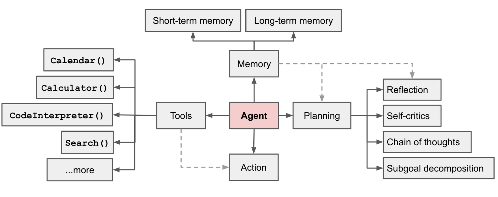
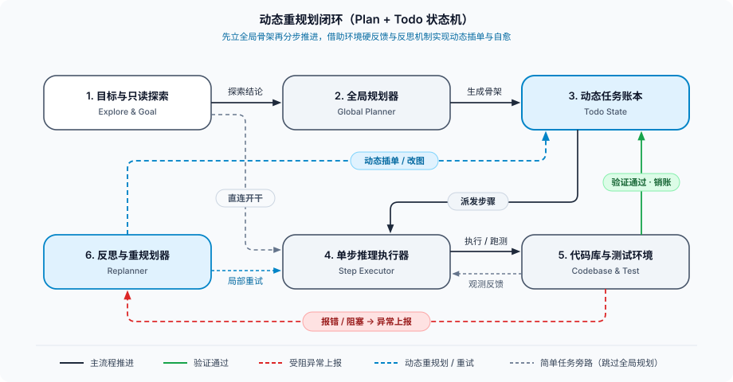
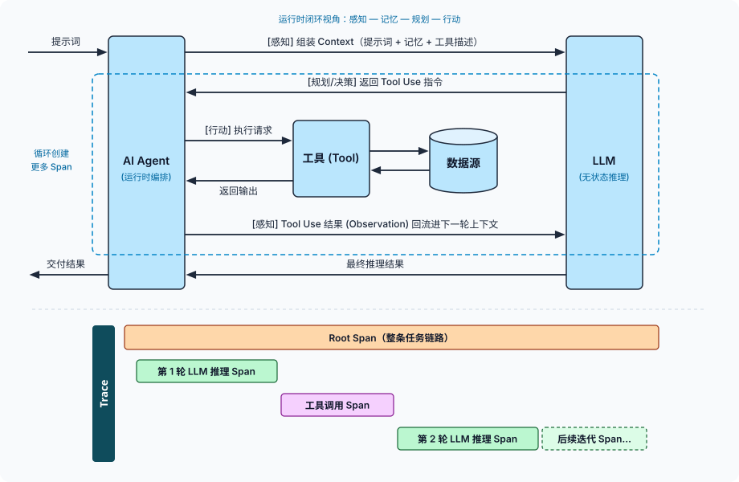
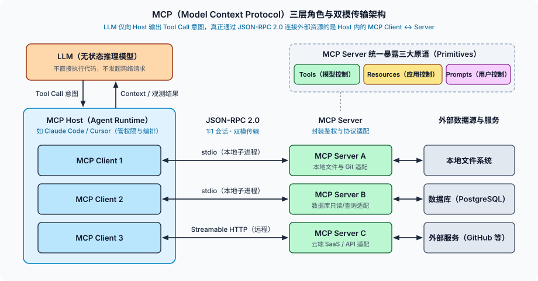

# Agent 基本认知

## 基础工作流

**Agent 工作流（Agentic Workflow）** 是以大语言模型（LLM）为核心推理引擎，围绕特定目标自主进行规划、调用工具，并根据环境反馈持续调整策略的动态执行机制。现代 Agent 并非单向流水线，而是以**记忆**为状态底座，在 **“感知—规划—行动”** 之间反复循环的闭环系统：

- **感知（Perception）**：收集本轮决策所需的外部信息、工具反馈与内部记忆，装配成模型可消费的上下文。
- **记忆（Memory）**：负责跨步骤与跨会话状态的存储、索引、检索与更新。
- **规划（Planning）**：基于当前上下文进行任务拆解、路径推演与反思纠偏。
- **行动（Action）**：输出自然语言回复，或生成结构化工具调用作用于外部环境（其返回结果再作为下一轮感知的输入）。

下图是 OpenAI 前安全研究主管 **Lilian Weng** 于 2023 年 6 月 23 日发表的经典博客《LLM Powered Autonomous Agents》中的架构总览图（*Fig. 1. Overview of a LLM-powered autonomous agent system*）：

> [!NOTE] 从经典概念图到现代工程四要素
> 原图从抽象能力视角将系统拆分为 **Memory、Planning、Tools、Action**；而在现代 Agent 工程（尤其是 Coding Agent）中，**Tools** 的声明被前置到上下文装配，工具执行归入 **Action**，而“如何将环境、历史、记忆与工具反馈统一组织成 LLM 输入”被显式提炼为独立的一环——即**感知（Context Engineering / 上下文工程）**。由此演进为 **感知 — 记忆 — 规划 — 行动** 的工作流范式。

### 感知

**感知（Perception）** 的本质是一个**多源上下文聚合与序列化器（Context Aggregator & Serializer）**。它负责在每轮推理前，将外部环境变化与内部系统状态统一转化为大模型能够理解的输入（结构化 Message 序列或原生多模态 Token 流）。

#### 1. 感知吞吐的五类核心输入源

感知层不仅接收用户的即时指令，通常需要聚合以下五类信息（其中记忆检索与工具执行分别由后续模块产出，由感知层统一消费与装配）：

1. **系统契约与能力声明（System & Capabilities）**：角色定位、安全边界、工程规范，以及可用工具（Tools Schema）、Skill 摘要、MCP 工具注册表。
2. **用户多模态输入（User Input）**：当前轮的文本指令，以及图像、音频、文档附件等（经编码为多模态 Token 或解析后的结构化文本）。
3. **会话历史与运行环境状态（Session & Environment）**：历史对话消息流，以及实时环境快照（如当前时间、OS、工作目录 `cwd`、Git 分支/变更状态、当前打开文件等）。
4. **工具反馈与环境观测（Observations）**：上一轮 Action 调用工具后的真实返回值（如终端 `stdout/stderr`、文件内容、检索结果、报错堆栈），这是闭环能够自我纠错的关键依据。
5. **记忆召回内容（Retrieved Memory）**：从短期工作记忆或长期记忆库（如向量库检索结果、跨会话摘要、项目级持久化规则文件）按需拉取并注入的片段。

#### 2. 分层注入策略（兼顾结构清晰与 Prompt Caching）

上述上下文并非“一锅炖”地每次从头拼接，而是会按**变化频率与生命周期**分阶段、以不同形式注入，从而兼顾模型注意力聚焦与服务端 KV Cache（Prompt Caching）命中率：

| 上下文层级 | 典型内容 | 注入形式与时机 | 工程考量 |
| :--- | :--- | :--- | :--- |
| **静态稳定前缀** | 核心身份指令、通用工作流规范、内置 Tool Schemas | 会话初始化时固定置于 System Prompt / Tool 定义区 | **最大化前缀缓存复用**，尽量不在每轮中修改 |
| **会话消息流** | 用户提问、模型思考与回复、`tool_use` / `tool_result` | 按对话轮次追加至 `messages` 序列尾部 | 维持因果时序，遵循“只追加（Append-only）”原则 |
| **动态/按需注入** | 环境状态变化、记忆/RAG 召回、触发后的 Skill 全文 | 在首条消息或当前轮以特殊标签（如 `<system-reminder>`）插入 | 避免污染静态前缀缓存，同时让实时状态处于高注意力区 |

#### 3. 无状态 API 下的 Context Window 治理

大模型 API 本身是**无状态（Stateless）** 的——服务端不会替你记住上一轮发生了什么，Agent Runtime 必须在每次请求前把“当前有效的完整状态”重新序列化并送入模型。同时，受限于 **Context Window 物理上限**以及 **长上下文下的注意力稀释（Context Rot）**，现代 Coding Agent（如 Claude Code）的感知层不能只做“加法”，还必须持续进行上下文治理：

- **观测清洗与截断（Observation Sanitizing）**：当工具输出超长日志或大文件时，截断冗余头部/中间内容、过滤 ANSI 控制符，或将全量输出落盘为临时文件、仅向上下文注入文件路径与关键摘要。
- **上下文压缩与退场（Compaction & Clearing）**：当上下文逼近阈值时，将早期探索过程压缩为结构化摘要（保留关键决策、已改文件、未决问题），或清理历史中已消费完毕的冗长旧 `tool_result`。
- **能力渐进式披露（Progressive Disclosure）**：面对大量 Skill 与 MCP 工具时，不在初始上下文中直接塞入全部文档与全量 Schema，而是先注册轻量级“名称 + 触发描述”索引，待模型判断相关时再按需加载完整说明书或具体工具定义。

##### 工程案例：以 Claude Code 为代表的初始上下文装配

在现代 Coding Agent 中，围绕“初始提示词（System Prompt + 初始上下文注入）”通常包含以下 **6 类核心模块**（其中静态部分驻留 System Prompt 以保缓存，项目级/动态部分常在首轮消息中按约定标签注入）：

1. **核心身份与交互准则**：Agent 定位、输出风格约束（简洁、基于工具实证、不编造未读代码）与安全红线。
2. **工程工作流纪律**：例如先检索/阅读再修改、优先使用专用文件工具而非盲目跑 Shell、修改后必须验证等行为规范。
3. **工具声明与使用契约**：内置工具（读写文件、搜索、终端执行等）的参数 Schema、并发/权限边界及调用注意事项。
4. **运行环境上下文**：工作区路径、操作系统与 Shell 环境、是否为 Git 仓库及基础状态、当前日期等。
5. **项目与用户级持久化指令**：自动发现并加载的规则/记忆文件（如全局与项目级 `CLAUDE.md`、持久化记忆索引等）。
6. **扩展能力注册表（Skills & MCP）**：已挂载 Skill 的轻量化目录描述，以及已连接 MCP Server 暴露的工具入口列表。

### 记忆

**记忆（Memory）** 系统的本质是 Agent 在无状态大模型之上构建出的**状态持久化与经验演化底座**。如果说“感知”决定了模型在这一毫秒能看到什么，那么“记忆”决定了 Agent 能否跨越单次推理与单次会话，**记住当前做到哪、掌握哪些知识、吸取过什么教训，以及遵循何种行为规范**。

#### 1. 分类体系：从“二分法”到 CoALA 四分法

传统视角常按时间跨度将记忆划分为 **短期记忆（Short-term）** 与 **长期记忆（Long-term）**；但在工程落地中，不同记忆的数据形态、读写权限与加载方式差异极大。目前业界普遍参考普林斯顿大学提出的 **CoALA（Cognitive Architectures for Language Agents）** 框架，将其细分为**一类短期记忆 + 三类长期记忆**：

| 记忆类型 | 核心定位 | 存放内容 | 典型工程载体 |
| :--- | :--- | :--- | :--- |
| **工作记忆** *(Working)* | 当前任务工作台 *(短期)* | 当前目标/子任务进度、近期对话、中间推理草稿、刚返回的工具观测 | **Context Window**、Runtime State/Checkpointer、任务临时文件（如 `TODO.md`） |
| **语义记忆** *(Semantic)* | 陈述性事实库 *(Know-What)* | 项目架构事实、业务术语表、API 文档、客观偏好（如“项目用 pnpm”） | 事实类 **Markdown**（如 `MEMORY.md`）、**向量库（RAG）**、**知识图谱** |
| **情景记忆** *(Episodic)* | 历史经验与轨迹库 *(Past Cases)* | 过往任务的交互轨迹摘要、成功解法路径、报错教训、用户纠正反馈 | 结构化经验日志、带元数据的向量库 |
| **程序性记忆** *(Procedural)* | 行为规程与技能库 *(Know-How)* | 行为红线、工作流 SOP、编码规范、工具调用策略与可复用技能 | **隐式**：模型权重 **显式**：System Prompt、规则文件（`CLAUDE.md`）、`SKILL.md` |

> [!TIP] 架构判据：存储载体可以共用，记忆本质必须正交
> 工程上很多记忆都以 Markdown 文件形式落盘，判断归属不应看文件后缀，而应看**信息本质**：
> - 记录**客观事实与状态**（*Know-What*，如“鉴权走 JWT”）属于**语义记忆**；约定**行动纪律与操作流程**（*Know-How*，如“改代码前先跑单测”或 `SKILL.md`）属于**程序性记忆**。
> - 同样是跨会话经验，**语义记忆**存的是去语境化的“通用结论”，**情景记忆**存的是带上下文与成败结果的“具体案例轨迹”。

#### 2. 运行闭环：读取、暂存、巩固与治理

记忆系统并非静态仓库，而是随任务生命周期持续流转的数据闭环（由 Agent Runtime 调度，并在每轮推理前交由感知层消费）：

1. **读取与路由（Retrieval & Loading）—— 任务启动与推理前**
   - **确定性挂载与渐进式披露**（主用于**程序性记忆**与核心轻量事实）：按工作目录层级自动加载规则文件（如 `CLAUDE.md`），或仅向初始上下文注入 `SKILL.md` 摘要，待模型触发后再按需加载全文。
   - **相关性动态检索**（主用于海量**语义记忆**与**情景记忆**）：结合向量检索、BM25 关键词或图谱多跳查询按需召回；排序上通常综合 **相关性（Relevance）× 时效性（Recency）× 重要性（Importance）**，将最匹配的事实与历史避坑案例注入本轮上下文。
2. **工作态维持（Working State）—— 任务执行中**
   - **工作记忆**是上下文最贴近感知的一层，主载体为 Context Window（依赖感知层的清洗、截断与压缩防止溢出）。
   - 为避免长程任务在多次压缩后丢失全局目标，现代 Agent 常将任务进度、阶段性决策等关键状态**外置固化**到文件系统（如 `TODO.md` / 计划文档）或 Runtime Checkpointer 中，作为“以文件/状态机为真理”的锚点。
3. **写入与巩固（Write & Consolidation）—— 任务收尾与异步演化**
   - 写入分两条路径：**模型显式写入**（任务中调用记忆工具记录重要事实）与 **Runtime 后台异步提炼**（会话结束后扫描轨迹去噪总结）。
   - **巩固（Consolidation）** 完成记忆升维与淘汰：一次性的试错细节随工作记忆释放；高价值客观事实沉淀进**语义记忆**；“上下文 → 动作 → 成败结果”的完整经验提炼进**情景记忆**，从而让 Agent 具备跨会话自我进化能力。
4. **治理与隔离（Governance & Scoping）—— 跨周期可靠性保障**
   - **冲突消解与更新**：长期记忆不能只增不删（例如“曾用 Python 3.10”与“已迁至 3.12”并存会导致召回幻觉），需要支持新旧覆写（Upsert）、合并与过期淘汰。
   - **作用域隔离（Scoping）**：严格划分 **User 全局级**（个人习惯）、**Project 仓库级**（项目事实与规范）与 **Session 任务级**（临时状态），防止跨项目污染。
   - **写权限收敛**：**程序性记忆**（系统约束与核心技能）一般不放任模型在运行时随意自改，而是由人工或独立审核流程维护，确保行为边界稳定可控。

#### 3. 以 Claude Code 为例子

将上述 CoALA 四分法对应到 Claude Code 的实际运行中，可以简单落到以下 4 个部分：

- **工作记忆**：当前会话的 Context Window（配合自动压缩 / `/compact` 摘要），以及任务执行中维护的 Todo / Plan 状态。
- **语义记忆**：自动记忆机制生成的 `MEMORY.md` 索引及其主题记忆文件（记录项目事实、环境配置与用户偏好，跨会话加载）。
- **情景记忆**：随交互不断沉淀的用户纠正反馈与踩坑经验（经提炼后写入记忆文件），以及本地落盘的会话历史轨迹（支持 `/resume` 回溯恢复）。
- **程序性记忆**：内置 System Prompt、按目录层级自动发现的 `CLAUDE.md` 工程规范，以及按“先摘要、触发后再读全文”渐进式披露的 `SKILL.md` 技能包。

### 规划

**规划（Planning）** 系统的本质是在大语言模型之上架设一层**任务分解（Task Decomposition）+ 依赖编排 + 异常重调度**的控制器。大语言模型在底层是**自回归逐 Token 预测器**，天然擅长局部顺滑续写；当直接面对跨越十几个步骤的复杂工程目标时，极易因为前置依赖缺失导致阻塞、长链条下的目标偏移（Goal Drift）以及错误级联放大导致的局部死循环。规划层的核心职责，就是把高不确定性的长跨度难题，拆解为**边界清晰、粒度可控、可独立验证的短跨度子任务**。

#### 1. 推理演进：从外置搜索拓扑到原生推理内化

从推理搜索拓扑的演进来看，大模型规划能力经历了“外挂搜索结构 $\rightarrow$ 内化为模型原生能力”的迁移：

- **早期（外置 Prompt 与采样拓扑）**：为了弥补单次前向推理的浅层直觉，业界通过外置结构引导模型“多想几步”——从线性展开的 **思维链（CoT）**，发展到多路径采样投票（Self-Consistency），再到显式引入分支探索与剪枝的 **思维树（ToT）**、**思维图（GoT）**。
- **现代（RL 内化与测试时计算）**：随着新一代推理模型（Reasoning Models）的成熟，通过大规模可验证奖励强化学习（RL）与测试时计算扩展（Test-time Compute），分支试错、自我校验与回溯（Backtracking）已被深度内化为模型单次前向中的**原生隐式思考能力（Internal Thinking）**。

> [!NOTE] 为什么原生推理能力变强了，依然需要显式规划层？
> 模型脑内的 Thinking 本质上仍是**闭门推演（Closed-book Mental Simulation）**——它无法在一次前向推理中凭空预知真实代码库的实际结构、外部命令的报错堆栈，或用户在执行中途提出的偏好调整。一旦任务涉及**多轮真实环境交互**、**长程状态持久化**以及**高风险变更的人机确认**，就必须由 Agent Runtime 将隐式推理拉出模型外部，与显式的工作流编排结合。

#### 2. 三种工作流范式与反思引擎

围绕“什么时候计划、什么时候行动”，现代 Agent Runtime 在工程上大致演化出三种核心编排范式：

| 范式 | 执行节奏（Plan vs. Act） | 核心优势 | 主要局限与适用边界 |
| :--- | :--- | :--- | :--- |
| **边想边做** *(ReAct / Interleaved)* | 单步循环：`Thought → Action → Observation` | 对环境变化极其敏捷，无额外规划启动开销 | 缺乏全局视野，多文件、跨阶段复杂任务容易走偏或陷入局部最优 |
| **先想后做** *(Plan-and-Execute)* | 先生成完整有序清单或 DAG，再分步执行 | 全局结构清晰，拆解后可用轻量模型/子代理并行执行 | 计划刚性强，一旦前置假设被环境报错推翻，后续静态步骤整体失效 |
| **动态重规划** *(Adaptive Replanning)* | **先立全局骨架，再按步推进，遇阻随时局部改图** | 兼顾全局目标一致性与环境纠错弹性 | 状态机与上下文管理更复杂；当前复杂 Agent 的主流范式 |

驱动“动态重规划”真正转起来的触发器，是架构图中的 **反思与自我校验（Reflection & Self-critics）**——即评估“上一步行动是否达到预期、是否偏离主线”：

- **硬反馈校验**：由编译器报错、单测失败、Linter 警告、命令 Exit Code 等客观信号直接触发重规划（最可靠、零幻觉）。
- **软自我批判**：由模型或独立的 Verifier / Critic 审视输出质量与目标一致性，判断是否需要回退、换路或向用户澄清。短期的失败反思直接触发当下的计划改写，跨任务的深刻教训则经由记忆系统沉淀进**情景记忆**。

#### 3. 以 Claude Code 为例子

以 Claude Code 为代表的现代 Coding Agent，通过一组务实的工程机制把“动态重规划”落到了日常开发流中：

- **Plan Mode（先探索再对齐）**：面对高风险或跨模块改造时，先以只读工具探索代码库并输出结构化改动方案，与用户确认边界后再进入写操作，避免在错误假设上盲目改动。
- **Todo / Task 显式外置**：将隐含在对话里的计划外置为结构化的任务列表状态（对应工作记忆），即便执行几十轮后触发上下文压缩，Agent 依然能锚定当前进度与剩余依赖。
- **测试与报错驱动的滚动修正**：在每次编辑后主动执行单测、类型检查或构建命令，一旦出现真实报错，立刻中断既定步骤并把错误堆栈作为新观测纳入局部重规划。
- **Subagent 委派隔离**：将高噪声的局部子任务（如大范围检索、独立模块调研）派发给 Subagent 执行，主规划器只消费精炼结果并更新主计划，防止主上下文被探索细节淹没。

### 行动

**行动（Action）** 是规划向真实世界的延伸。大语言模型本身只能输出文本或结构化 `tool_call` 意图，无法直接改变外部环境；真正负责落地执行、承受副作用并回收观测结果（Observation）的是外层的 **Agent Runtime**。其主干逻辑是在 **“外部确定性编排（循环上限、状态机约束、安全校验）+ 内部模型自主编排”** 的协同下，围绕动态维护的任务状态机（如 To-do List），通过 **直接输出文本**（阶段收敛或交付结果）与 **发出工具调用**（推动状态向前并触发并发/串行调度与报错重试）两个原子行为循环推进。

在此循环之上，现代 Agent 的行动能力通常解耦为三层，并由执行护栏兜底：

- **原子工具层（Built-in Primitives）**：Runtime 内置的最小操作原语（文件读写、代码检索、终端执行等），直接承担底层动作落地。
- **开放协议层（MCP）**：通过统一协议标准化接入数据库、GitHub、浏览器等外部服务，解决异构系统的可插拔扩展。
- **复合能力层（Skills）**：将多步工具调用规程与配套脚本封装为高可靠技能模块，避免模型每次从零拼凑复杂调用链。

同时，Runtime 借助**沙箱隔离与分级权限拦截**（区分只读、可逆写与高危不可逆操作）守住副作用边界，并将执行产出的真实环境反馈回流至下一轮**感知**，由此闭合整个 `感知 — 记忆 — 规划 — 行动` 工作流。

### 总结

纵观现代 Agent 工作流，四大核心环节各司其职、首尾相扣：**感知**决定了无状态模型在这一步能看到什么，**记忆**决定了系统能跨越时间留存并演化什么，**规划**决定了复杂目标如何被拆解与动态纠偏，**行动**决定了抽象意图如何安全地作用于真实世界。

当把这四个模块放进真实的工程运行时（Runtime）中观察，它们并非顺序跑完一次就结束，而是在 **`AI Agent Runtime ↔ LLM ↔ Tool`** 之间不断迭代推进。在工程可观测性（Observability / Tracing）视角下，一次完整的用户请求对应一条 **Trace（Root Span）**；循环中的每一轮上下文装配与 LLM 推理、每一次外部工具调用，则展开为时间轴上首尾相接的一个个子 **Span**，直到模型不再发出工具调用并交付最终结果：

## 工具扩展机制

围绕大模型原生的 **Function Calling（函数调用）** 底座，现代 Agent 生态演化出了职责分明的扩展体系。其中必须明确一条前提：**大模型本身永远不会执行任何一行代码，也不会发起任何一次网络请求**——它只负责输出结构化的调用意图，真正执行动作并承载能力扩展的，始终是外层的 **Agent Runtime**。

在此前提下，扩展机制沿着两条正交主线演进，并最终通过容器化机制打包分发：

- **标准化协议（MCP）**：解决**外部生态的连接成本**问题（把 $M \times N$ 的碎片化接口收敛为标准协议）。
- **渐进式披露（Skills 与工具懒加载）**：解决**内部上下文的加载效率**问题（避免海量工具 Schema 与领域文档占满 Context Window、稀释注意力）。
- **工程分发容器（Plugins）**：将特定场景所需的 MCP 配置、Skills、Hooks 与 Subagents 打包为可一键安装、启停的集成单元。

### MCP 协议

**外部集成的 $M \times N$ 困境**：若有 $M$ 个 AI 客户端（Claude Code、Cursor、Zed、自研 Agent）想接入 $N$ 个数据源或工具（GitHub、PostgreSQL、Sentry、Notion），每个客户端团队都得针对不同平台的鉴权方式与返回格式重写一套胶水代码，维护成本呈乘积爆炸。**MCP（Model Context Protocol）** 通过建立统一协议，将问题降维为 $M + N$。

结合图中的模块连接关系，MCP 的运行原理可拆解为**三层角色、三大原语与双模传输**：

- **三层角色（Architecture）**：
  - **Host（宿主应用 / Agent Runtime）**：如 Claude Code、Cursor，负责管理 LLM 对话循环、权限确认与 Client 生命周期（注意：**Host 是外层 Runtime，而非 LLM 本身**）。
  - **Client（协议客户端）**：运行在 Host 内部，通常与目标 Server 一一对应建立会话，负责协议握手、能力协商与 JSON-RPC 路由。
  - **Server（能力提供方）**：轻量级独立进程或远程服务，封装外部系统的鉴权与接口适配，向上暴露标准化能力。
- **三大原语（Primitives，按控制权划分）**：
  - **Tools（工具 — 模型控制）**：可执行操作（如查库、写文件、调外部 API），由 LLM 在推理时自主决定何时发起调用意图。
  - **Resources（资源 — 应用控制）**：只读数据视图（如文件内容、日志、表结构 Schema），由宿主应用按需读取并注入上下文。
  - **Prompts（提示词模板 — 用户控制）**：Server 预置的可复用工作流模板或斜杠命令，通常由用户显式触发。
- **双模传输（Transports，统一基于 JSON-RPC 2.0）**：
  - **本地进程通信（`stdio`）**：Host 在本地拉起 Server 子进程，通过标准输入输出流交互，零网络开销，适合本地工具与文件访问。
  - **远程网络通信（Streamable HTTP，早期亦包含 HTTP+SSE）**：通过标准 HTTP 流式传输跨机通信，适合团队共享、云端部署与 SaaS 服务集成。

> [!TIP] MCP 同样面临上下文膨胀问题
> 接入 MCP 解决了“怎么连”，但如果一口气挂载几十个 Server、暴露上百个 Tool Schema，初始上下文照样会被占满。因此现代 Runtime 往往配合**工具懒加载（Tool Search / Deferred Loading）**：启动时仅暴露轻量目录，模型需要时再按需检索拉取具体 Tool 的完整 Schema。

### Skills 技能机制

如果说 MCP 解决的是“**能连上什么工具**”，那么 **Skills** 解决的是“**在特定领域该如何正确、高效地组合使用工具**”。其核心原理是把**领域程序性记忆（SOP）+ 确定性辅助脚本**封装成自包含的文件目录，并通过**三层渐进式披露（Progressive Disclosure）** 实现低开销按需挂载：

1. **第 1 层：元数据层（Agent 启动时加载）**
   - 仅将每个 Skill 的 `name` 与触发 `description`（界定何时该用、何时不该用）注入初始上下文，单个技能仅占用几十个 Token，挂载再多技能也不会挤占主窗口。
2. **第 2 层：指令层（任务匹配触发时加载）**
   - 当模型判断当前任务匹配某个 Skill 描述时，才按需读取其 `SKILL.md` 正文，载入完整工作流步骤、边界约束与输入输出验收标准。
3. **第 3 层：资源与脚本层（执行过程中按需加载/运行）**
   - 随目录携带的 `references/`（参考文档）、`assets/`（模板素材）与 `scripts/`（确定性脚本）平时零上下文占用；执行时按需局部读取文档，**脚本则直接由 Runtime 执行、仅将精简结果回传上下文**——既省 Token，又把“容易出错的步骤”从概率推理转化为确定性计算。

#### MCP、Skills 与 Plugins 的职责边界

| 扩展机制 | 核心解决的问题 | 本质定位 | 典型载体 |
| :--- | :--- | :--- | :--- |
| **MCP** | 外部系统异构集成的 $M \times N$ 连接成本 | **标准化接口层**（给 Agent 装上手脚与外设） | `stdio` 子进程 / 远程 HTTP 服务 |
| **Skills** | 领域 SOP 复用与上下文 Token 爆炸问题 | **程序性知识与方法论层**（教 Agent 按规程干活） | `SKILL.md` + `scripts/` / `references/` |
| **Plugins** | 多类扩展组件的散乱配置与协同复用成本 | **工程打包与分发容器**（按场景一键装卸） | 打包了 MCP、Skills、Hooks、Subagents 的插件包 |
