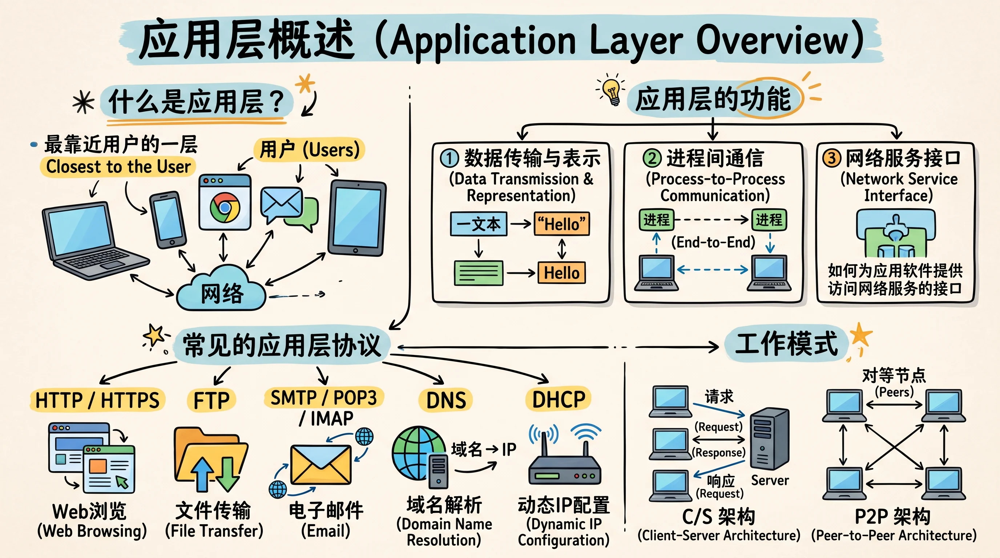

# 应用层概述

在五层体系结构中，应用层是直接面向用户的一层，因而相比之下，应用层的目的不再是提供某种通用的通信能力，而是为不同的网络应用定义具体的通信规则。**应用层关心的问题是如何完成应用进程之间有意义的交互，从而实现特定的网络应用功能**，对于具体的场景：

- 如果是 HTTP 请求，服务器需要判断请求方法、资源路径等。
- 如果是 DNS 查询，服务器需要理解查询的域名和记录类型。
- 如果是 SMTP 命令，邮件服务器需要按照邮件传输规则处理。
- 如果是游戏数据，客户端需要理解玩家位置、技能释放等信息。

应用的目标和数据语义差异很大，很难用一种统一的应用层协议完成所有工作。因此，应用层自然形成了大量面向不同需求的协议。从应用层基本原理学起，重点学习几种关键协议。
