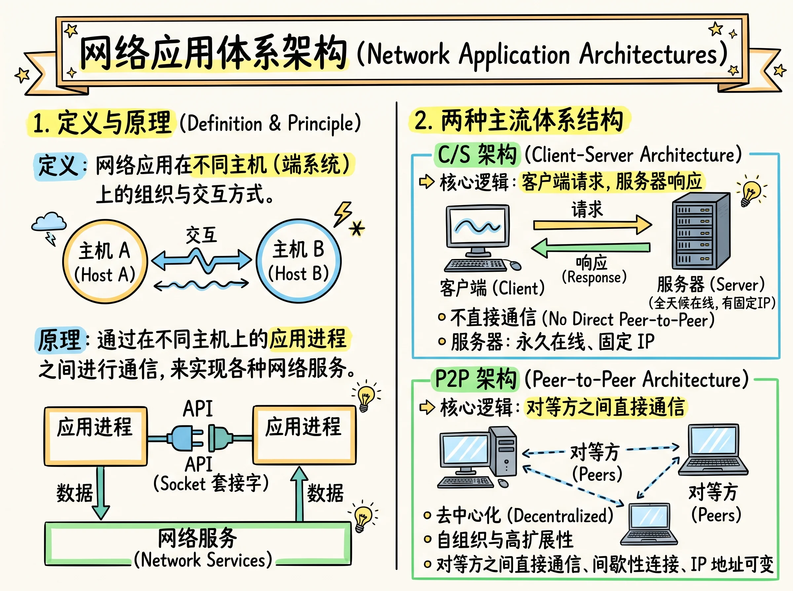
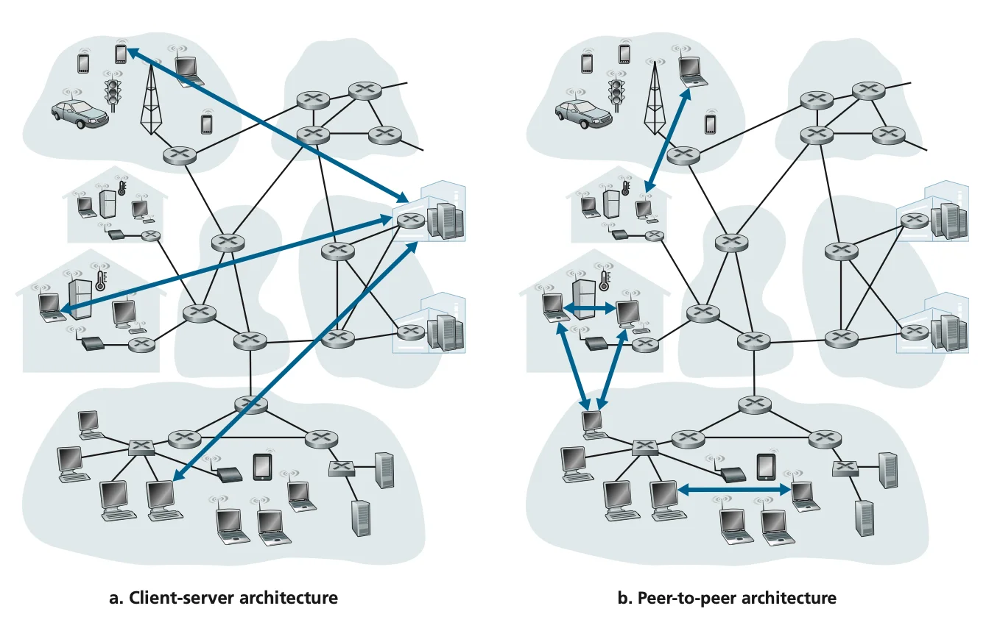
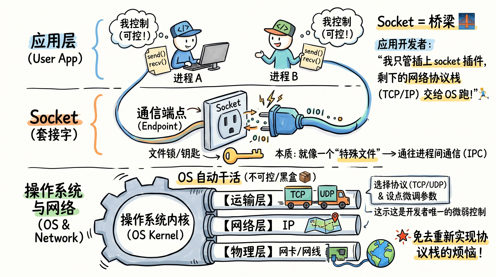
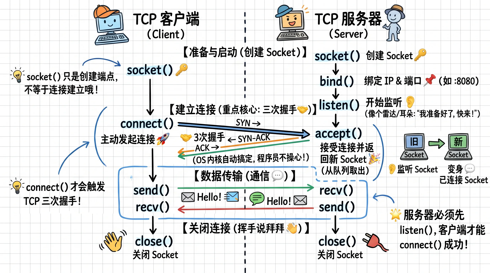

# 应用层基本原理

## 网络应用体系结构（Network Application Architecture）

**网络应用体系架构**是由应用程序研发者设计的，规定了应用程序如何在不同的端系统（End Systems / Hosts）之间组织、分配角色以及进行进程间通信（IPC）的顶层拓扑结构。

**网络应用体系架构**是由应用程序研发者设计的，规定了应用程序如何在不同的端系统（End Systems / Hosts）之间组织、分配角色以及进行进程间通信（IPC）的顶层拓扑结构。在选择网络应用体系架构时，底层网络（路由器、交换机）对开发者而言是一个提供数据传输服务的“黑盒”。

目前现代网络应用主要采用两种主流的体系结构：

- **客户端-服务器架构（Client-Server Architecture，C/S）**
  - 存在一个常开的主机（**服务器 Server**），用于响应来自众多其他主机（**客户端 Client**）的请求。
  - 服务器需要承担大量计算和网络流量，大型服务通常在 **数据中心（Data Center）** 中运行成千上万台服务器以创建强大的虚拟服务器。
  - 客户端之间**不直接通信**。
  - **典型案例**：浏览器访问网页（HTTP/HTTPS）
- **对等架构（Peer-to-Peer Architecture，P2P）**
  - **去中心化**：极少或不依赖数据中心中的专用服务器，而是依靠分布在家庭、办公室的主机（称为**对等方 Peers**）之间直接互相通信。
  - **自扩展性（Self-Scalability）**：每个 Peer 在请求数据的同时也在向其他 Peer 分发数据，从而增加系统的整体吞吐能力。
  - **节点流动（Peer Churn）**：节点动态加入和退出。
  - **典型案例**：BitTorrent

> [!TIP] 混合架构的使用
> 需要注意的是，两种体系架构并非二选一的关系，许多应用会采用**混合架构**，结合 C/S 的集中式管理优势与 P2P 的低成本高吞吐能力。通常利用中心化服务器**处理控制面（Control Plane）逻辑**（如用户认证、在线状态追踪、元数据索引、信令握手），而在对等节点之间**直接建立数据面（Data Plane）传输通道**。

## 进程间通信（Processes Communicating）与 Socket

进程间通信其实就是不同进程之间如何交换数据，进程间通信分为两种典型场景：

| 通信场景 | 通信方式 |
| --- | --- |
| 同一主机上的进程 | 共享内存、管道、Unix Domain Socket 等 IPC 机制 |
| 不同主机上的进程 | 通过网络协议栈和 Socket 交换数据 |

应用层主要关注**不同端系统上的应用进程如何通过网络交换数据**。在一次具体的通信中，可以根据进程承担的角色进行区分：

- **客户端进程（Client Process）**：主动发起通信的进程。
- **服务器进程（Server Process）**：等待其他进程发起通信的进程。

需要注意，客户端与服务器的角色并非始终固定。同一个进程可以在不同的通信中分别承担客户端和服务器角色。例如，在 P2P 文件共享中，一个节点既可以主动向其他节点请求文件，也可以等待其他节点请求自己提供文件。

> [!NOTE] 与 C/S 架构的区别
> C/S 描述的是**整个网络应用的组织架构**，客户端进程与服务器进程则描述**具体通信中的角色**。两者并不矛盾，只是关注的层次不同。

### Socket

**Socket 是操作系统向应用程序提供的网络通信端点。应用进程通过 Socket API 使用运输层及更低层提供的网络服务。** 在 Unix/Linux 哲学中，**Socket 的本质并不是“网卡接口”，而是操作系统内核为“进程间通信（IPC）”提供的一种通用文件描述符（File Descriptor）抽象**。

在这个过程中，应用开发者可以控制套接字应用层一侧的所有内容，但对套接字运输层一侧几乎无法控制。应用开发者对运输层一侧唯一的控制是：(1) 选择运输协议；(2) 或许能够设定一些运输层参数，例如最大缓冲区和最大报文段长度。一旦应用开发者选择了一种运输协议，该应用就是使用该协议所提供的运输层服务构建的，这些任务是由操作系统完成的。总结而言：**应用程序只需要使用通信接口，不需要重新实现整个网络协议栈。**

#### Socket 编程（Socket Programming）

以 **TCP** 连接为例：TCP 客户端与服务器的通信过程可以分为三个阶段：**准备与监听、建立连接、数据传输与关闭连接**。

1. **准备与监听**：双方通过 `socket()` 创建套接字；服务器通过 `bind()` 和 `listen()` 进入监听状态。
2. **连接建立**：客户端调用 `connect()` 发起连接，由操作系统完成 TCP 三次握手；服务器通过 `accept()` 获取已建立连接对应的新 Socket。
3. **数据传输与关闭连接**：双方通过 `send()/recv()` 交换数据，通信结束后调用 `close()` 关闭 Socket。

> [!NOTE] 核心区别
> - `socket()` 仅创建通信端点，不代表建立 TCP 连接。
> - **监听 Socket** 负责接受新连接，**连接 Socket** 负责具体的数据通信。
> - `accept()` 返回新的连接 Socket，原监听 Socket 仍然存在。
> - TCP 连接建立、可靠传输和连接关闭由操作系统的 TCP 协议栈处理。

