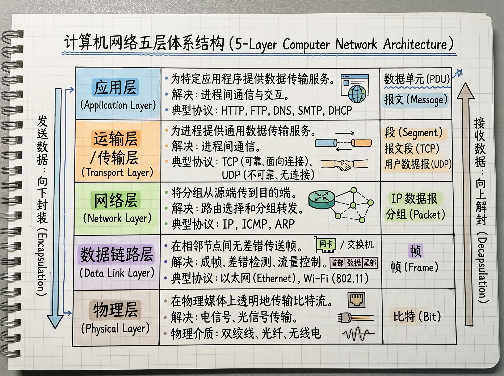

# 计算机网络的五层体系结构

计算机网络分层模型不是为了描述网络中真实存在的五个独立模块，而是为了把一个复杂的通信问题拆解成若干职责明确、可以协作的子问题。

它们关注的核心问题都是：**如果计算机 A 要给计算机 B 传输数据，要怎么做？**

它包含了一系列核心问题：

1. 数据如何传输？是电信号、光信号，还是无线电波？
2. 设备如何连接？在同一个局域网里，怎样找到目标设备？
3. 跨网络如何到达？如果 A 在杭州，B 在北京，中间经过哪些路由器？
4. 如何提供端到端的传输服务？数据丢失了怎么办？乱序了怎么办？发送太快怎么办？
5. 应用如何理解数据？收到的字节究竟是网页、图片，还是一条聊天消息？

这些问题都围绕网络通信展开，但各自的关注点不同。因此，计算机网络采用**分层、抽象、封装与解耦**的设计思想，将复杂的通信任务拆解为职责明确、相互协作的多个层次，并通过各层的网络协议共同完成通信。

分层最大的价值不仅是把复杂问题拆开，更是让每一层可以在不破坏层间接口的前提下独立演进。

## 本专题章节

| 层次 | 关注问题 | 已整理笔记 |
| --- | --- | --- |
| **应用层** | 应用进程如何交换有语义的数据 | [概述](./application/overview) · [应用层基本原理](./application/principles) |
| **传输层** | 如何提供端到端的进程间传输服务 | [概述](./transport/overview) · [传输层基本原理](./transport/principles) · [TCP](./transport/tcp) |
| **网络层** | 跨网络如何路由到达目标主机 | *待整理* |
| **数据链路层** | 相邻节点间如何成帧与无差错传输 | *待整理* |
| **物理层** | 物理介质上如何传输比特流 | *待整理* |
