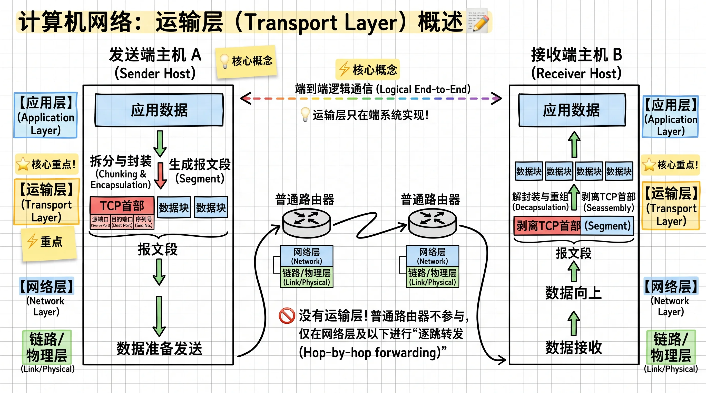
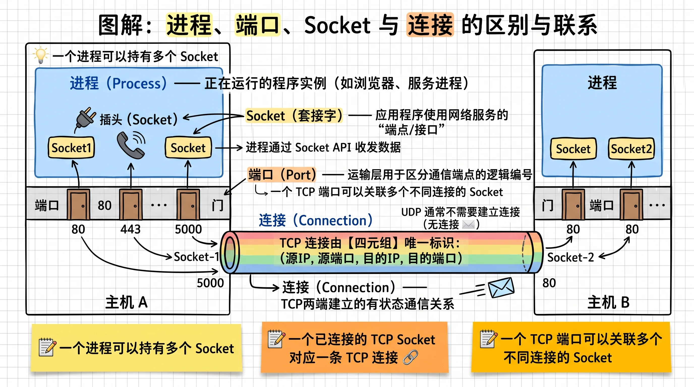

# 传输层基本概念

运输层介于应用层和网络层之间，负责接收应用进程通过 Socket 提交的数据，并根据所使用的协议进行处理、封装，再交给网络层传输。它建立的是**进程和进程**之间的**逻辑通信**，因此具有如下特点：

1. 只在端系统（通信双方的主机）中实现，不参与普通路由器的逐跳转发。
2. 数据从发送端到接收端，需要经历封装与解封装。
3. 可以选择不同协议（TCP/UDP），为应用程序提供不同的传输服务。

需要注意，网络层提供的是**主机到主机**之间的逻辑通信，依靠 IP 地址；而运输层进一步通过端口和 Socket 机制来向具体的进程交付数据。

*什么是接受应用层产生的数据？*

应用进程通过 Socket 接口将数据交给运输层。传输层的一项基础功能是**多路复用与多路分解（Multiplexing / Demultiplexing）**：

- 多路复用：发送端从多个 Socket 接收数据，分别添加运输层首部，再交给网络层发送。
- 多路分解：接收端根据运输层首部及相关地址信息，将收到的数据交付给对应的 Socket。

> [!NOTE] 进程、端口、Socket 与连接的区别
> - **进程（Process）**：正在运行的程序实例，一个进程可以持有多个 Socket。
> - **端口（Port）**：运输层用于区分通信端点的逻辑编号，TCP 和 UDP 各有自己的端口空间。
> - **套接字（Socket）**：应用程序使用网络通信服务的端点，通过 Socket API 收发数据。
> - **连接（Connection）**：TCP 两端建立的有状态通信关系，通常由源 IP、源端口、目的 IP、目的端口组成的四元组唯一标识。
>
> 一个进程可以持有多个 Socket；一个 TCP 端口可以关联多个不同连接的 Socket；一个已连接 TCP Socket 对应一条 TCP 连接。UDP 通常不需要建立连接。
>
> 

## 应用层对传输层提出的四种服务需求

| 服务需求 | 核心问题 | 典型应用 |
| --- | --- | --- |
| 可靠数据传输（Reliable Data Transfer） | 数据能否完整、正确地到达？ | 文件传输、电子邮件 |
| 吞吐量（Throughput） | 能否提供足够的数据传输速率？ | 视频流、文件下载 |
| 定时（Timing） | 数据能否在规定时间内到达？ | 网络电话、实时游戏 |
| 安全性（Security） | 能否保护数据的机密性、完整性和通信身份？ | 网上银行、HTTPS |
