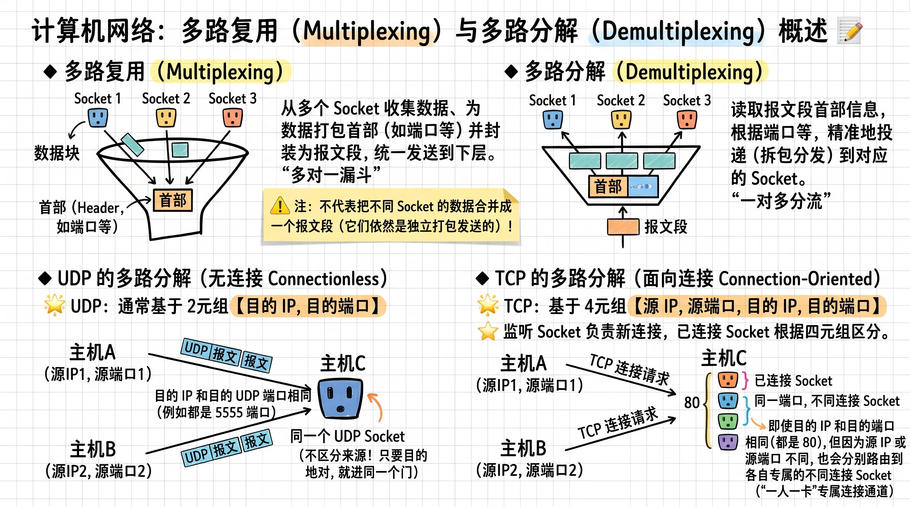
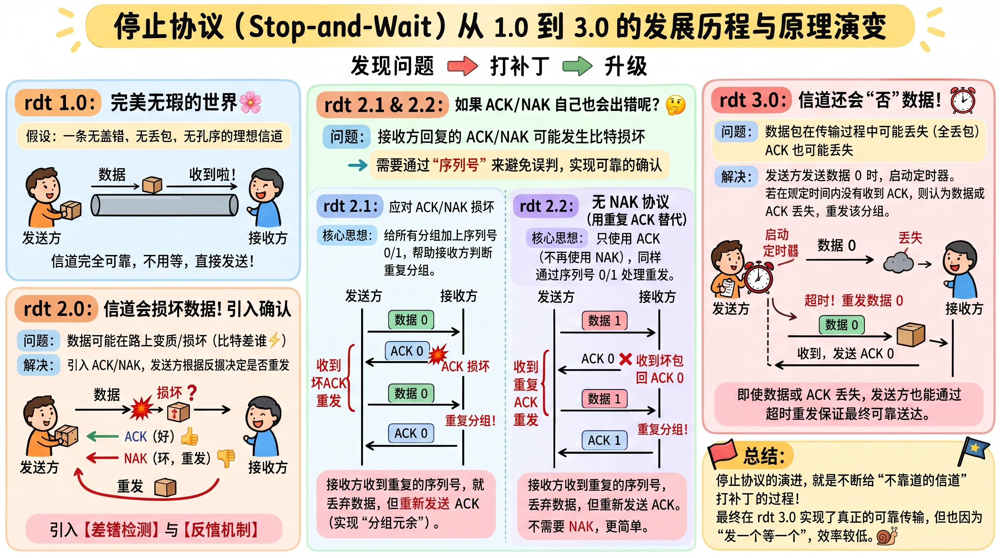
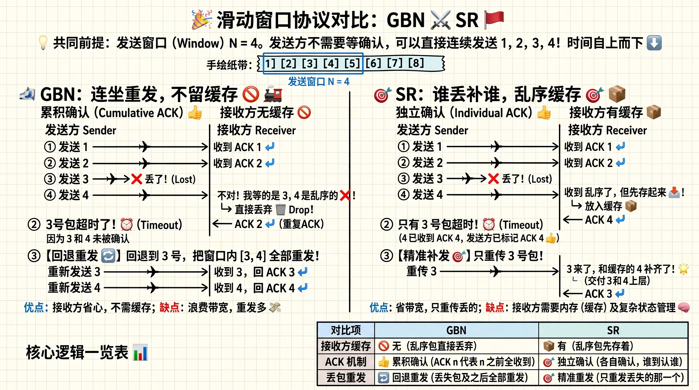

# 传输层基本原理

## 多路复用与多路分解（Multiplexing / Demultiplexing）

- **多路分解（Demultiplexing，分用）**：在接收端主机，传输层从底层的网络层接收到报文段（Segment）后，检查报文段首部中的特定字段，标识出对应的接收套接字（Socket），并将数据定向交付给该套接字的过程。
- **多路复用（Multiplexing，复用）**：在发送端主机，传输层从不同的套接字收集数据块，为每个数据块封装包含首部信息（用于后续的多路分解）的报文段，然后将这些报文段传递给网络层发送的过程。

### TCP 和 UDP 的分用依据

| | UDP | TCP |
| --- | --- | --- |
| 典型分用依据 | 目的 IP + 目的端口 | 四元组 `(源 IP, 源端口, 目的 IP, 目的端口)` |
| 不同客户端访问同一端口 | 通常交给同一个 Socket | 可以交给不同的连接 Socket |
| 是否区分不同的客户端连接 | 默认不建立连接 | 是 |

对于 **TCP 服务器**：

- **监听 Socket**：绑定服务端端口，负责处理新连接的建立。
- **连接 Socket**：与某个客户端的 TCP 连接对应，负责实际数据通信。

## 可靠数据传输理论（Principles of Reliable Data Transfer，RDT）

可靠数据传输原理的目标是在不可靠的底层信道（如 IP 层，可能发生比特损坏、丢包、乱序）之上，为上层应用提供一个“可靠信道”的抽象（保证数据无差错、不丢包、不重复、按序送达）。其基于以下的基本问题维度：

| 问题 | 说明 |
| --- | --- |
| 比特差错 | 传输中 0/1 翻转，需要差错检测（校验和）与差错恢复（ACK/NAK、重传） |
| 丢包 | 数据或确认丢失，需要超时重传（定时器） |
| 重复 | 重传导致接收方收到重复分组，需要序号机制去重 |
| 乱序 | 多分组并行时到达顺序错乱，需要序号与缓冲/排序 |

### RDT 1.0 到 RDT 3.0

**RDT 1.0** 是一种理想状况，它假设底层信道 100% 可靠，不会翻转比特，也不会丢失分组，且接收方处理速度无限快。但是现实物理链路受电磁干扰、路由器缓冲区溢出影响，这种理想信道不存在。

**RDT 2.0** 面向的问题是**物理链路出现噪声，数据包里的比特在传输中被篡改了怎么办。** 于是引入了自动重传机制：

- **差错检测（Checksum）**：发送方在包头附带校验和，接收方据此判断比特是否受损。
- **接收方反馈（ACK / NAK）**：好包回传 `ACK`（肯定确认），坏包回传 `NAK`（否定确认）。
- **重传（Retransmission）**：发送方收到 `NAK` 后，重新发送刚才缓存的分组。

停等机制在这里诞生，发送方状态机从 1 个状态拆分为 2 个（等待上层调用和等待 ACK / NAK），在处于“等待 ACK/NAK”状态时，发送方**不能**从上层接收新数据，这就是停等（Stop-and-Wait）的由来。这种机制的问题在于如果 `ACK` 或 `NAK` 在返回途中也发生了比特差错，就会造成重复包的问题。

**RDT 2.1** 为了解决**确认报文受损与重复包问题**，于是在数据分组头中加入**序列号（Sequence Number）** 以区分是否为重复包。

- *为什么 0 和 1 就足够区分？*
  - 因为是停等协议，发送方只有确认当前包被妥善接收后才会发下一个包，信道中同时最多只涉及“当前包”和“紧接着的下一个包”，因此就足够区分。

**RDT 2.2** 在此基础上进一步进行了**协议瘦身**，直接去掉 `NAK`，在 `ACK` 中标注所确认的序列号（`ACK 0` 或 `ACK 1`）。

- 当接收方期望收到 `1` 号包，却收到了损坏的包（或重复的 `0` 号包）时，它不再发 `NAK`，而是再次发送 **`ACK 0`**（表示“我最新正确收到的依然是 0 号包”）。发送方在等待 `ACK 1` 时若收到了 `ACK 0`（即**重复 ACK / Duplicate ACK**），就明白 1 号包出问题了，立即重传 1 号包。

**RDT 3.0** 是为了对抗**信道丢包**，发送方引入**倒计时定时器（Countdown Timer）** 以及**超时重传**机制。每发送一个新数据包，立即启动定时器。若在定时器超时（Timeout）前收到对应的 `ACK`，则停止定时器，进入下一序号发送状态。否则，立即触发**超时重传**，并重启定时器。

### 流水线可靠数据传输协议

采用停等协议，每发送一个分组，都要等待确认才能继续发送下一个，导致链路利用率可能很低。因此引入**流水线协议**允许发送方在**还没收到确认（ACK）之前，连续发送多个数据包**。

区别于停等协议，引入流水线协议需要解决下面三个问题：

- **序列号范围需要扩大**
- **收发双方必须引入缓冲区（Buffer）与“滑动窗口”**
- **需要更复杂的确认与重传机制**

针对以上三个问题，尤其是第三个问题，诞生了 **GBN 和 SR 协议**，它们都采用了滑动窗口（Sliding Window）机制：只允许发送落入窗口大小 $N$ 内的分组，一旦最老的分组被确认，窗口就向前滑动一格。

#### GBN（Go-Back-N，回退 N 步协议）

GBN 的核心设计思想是：**把复杂性全留给发送方，让接收方尽可能简单（不需要任何乱序缓存）**。

采用累积确认与滑动窗口，接收方只接受按序到达的分组。当最早未确认分组超时，发送方重传该分组及其后所有已发送但未确认的分组。

发送方原则：

- 维护大小为 $N$ 的发送窗口，允许连续发送多个未确认分组。
- 采用**累积确认（Cumulative ACK）**，`ACK(n)` 表示截至 $n$ 的分组均已按序接收。
- 通常只为最早未确认分组维护一个重传定时器。
- 收到新的累积 ACK 后，发送窗口向前滑动。

接收方原则：

- 接收窗口大小为 1，只接受当前期望的分组。
- 遇到乱序分组时直接丢弃，不进行缓存。
- 返回最近一个按序接收分组的 ACK。

该方法接收方硬件成本极低（连缓存都不用）；但如果链路误码率高、窗口大，丢 1 个包就要重传后面几十个其实早就到过的包，**带宽浪费极其严重**。

**窗口大小**：若序列号使用 $k$ 位，序列号空间大小为 $2^k$，则发送窗口应满足：

$$
N \leq 2^k - 1
$$

#### SR（Selective Repeat，选择重传协议）

SR 的核心设计思想是：**谁丢了就只重传谁**。采用独立确认与滑动窗口，接收方允许缓存乱序分组，发送方只重传发生超时的分组，避免不必要的重复传输。

发送方原则：

- 维护大小为 $N$ 的发送窗口，允许连续发送多个未确认分组。
- 采用**独立确认（Individual ACK）**，`ACK(n)` 仅确认分组 $n$。
- 为每个未确认分组分别管理定时器。
- 收到 ACK 后记录对应分组已确认；只有窗口基序号及其后连续分组均已确认时，窗口才能向前滑动。

接收方原则：

- 接收窗口可以大于 1。
- 对接收窗口内的乱序分组进行缓存，并分别发送 ACK。
- 当缺失分组到达后，将连续按序的数据交付上层，并滑动接收窗口。
- 对重复到达且属于已接收范围的分组，必要时重新发送 ACK。

**窗口大小**：若序列号使用 $k$ 位，且发送和接收窗口大小均为 $N$，则必须满足：

$$
N \leq 2^{k-1}
$$

避免序列号循环使用时，新旧分组产生歧义。

::: details GBN 与 SR 的窗口大小为什么受到限制？
**核心原因：防止序列号循环使用后，接收方无法区分新分组与旧分组的重传。**

假设序列号使用 $k$ 位，序列号空间大小为 $2^k$，通用窗口约束为：

$$
W_S + W_R \leq 2^k
$$

**1. GBN：为什么 $W_S \leq 2^k - 1$？**

GBN 的接收窗口 $W_R = 1$。假设 $k = 2$，序列号为 `0、1、2、3`。

- 如果发送窗口为 4，发送方连续发送 `0、1、2、3`。
- 接收方全部收到，下一轮期望序号重新变成 `0`。
- 如果 ACK 全部丢失，发送方超时重传旧 `0`，接收方会误认为这是新一轮的 `0`。

因此，GBN 必须保留至少一个序号作为新旧分组的区分空间：

$$
\boxed{W_S \leq 2^k - 1}
$$

**2. SR：为什么 $W_S = W_R \leq 2^{k-1}$？**

SR 允许缓存乱序分组。假设 $k = 2$，发送和接收窗口均为 3。

- 发送方发送 `0、1、2`，接收方全部收到。
- 接收窗口滑动为 `[3, 0, 1]`。
- 如果 ACK 全部丢失，发送方重传旧 `0`。
- 旧 `0` 恰好位于新的接收窗口中，接收方可能将其误认为新分组。

因此，必须避免旧发送窗口与新接收窗口在序列号循环时产生歧义。对于等大窗口：

$$
2W_S \leq 2^k \Rightarrow \boxed{W_S = W_R \leq 2^{k-1}}
$$

**总结：** GBN 的接收窗口只有 1，因此发送窗口最多占据序列号空间的 $2^k - 1$；SR 的接收窗口可以大于 1，等大窗口时两者最多各占序列号空间的一半。
:::
