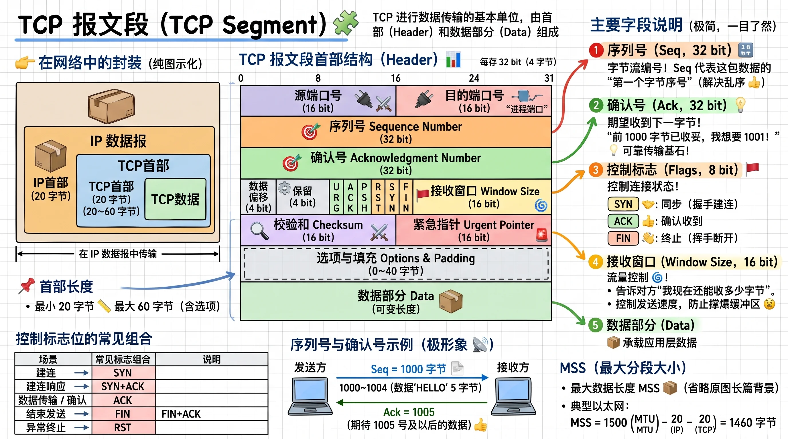
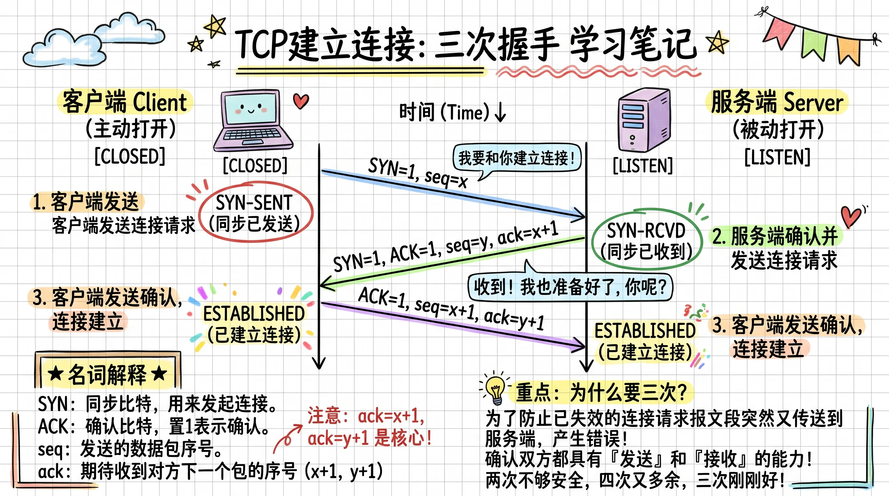
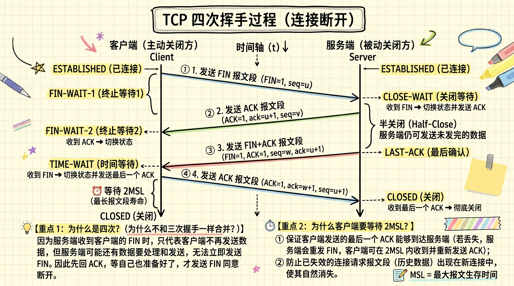
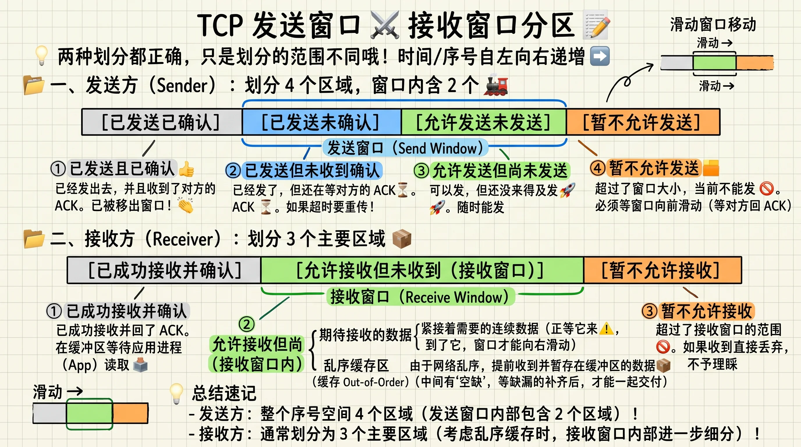
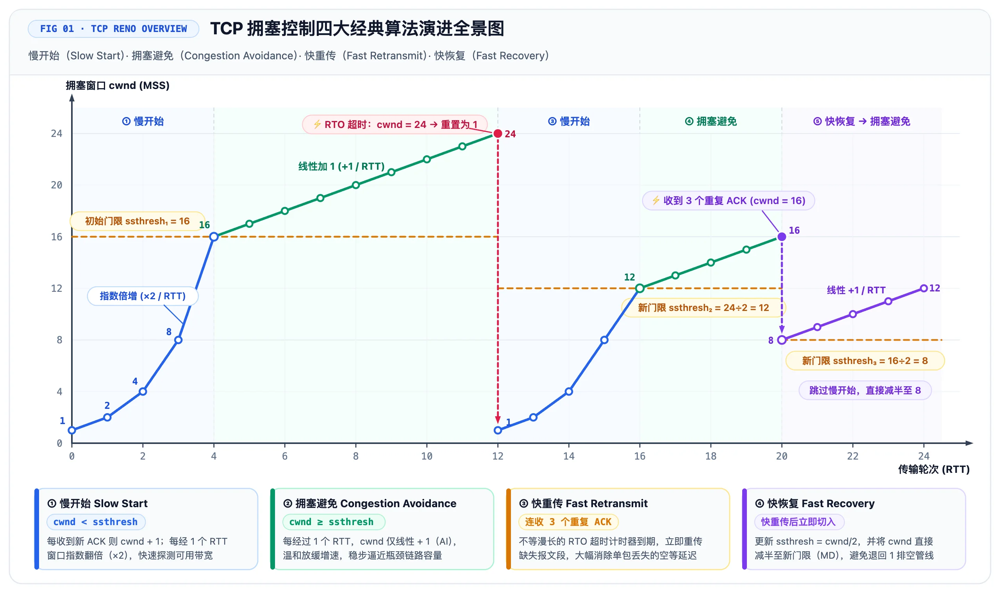
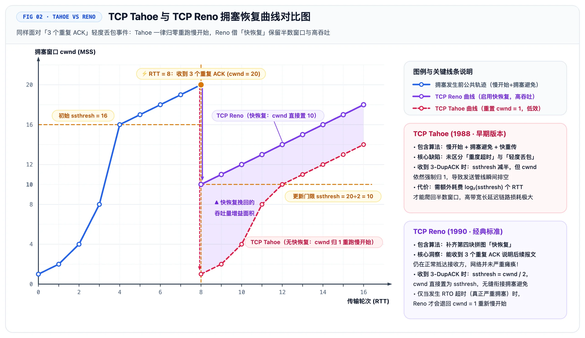

# TCP

**TCP 连接**是两个通信端点之间建立的**有状态、全双工的逻辑通信关系**，由通信双方的 TCP 协议栈共同维护，用于提供可靠、有序的字节流传输服务。

定义涵盖了以下标签：

- **面向连接的**：通过源 IP、源端口、目的 IP、目的端口构成的四元组区分不同连接。通过三次握手建立连接，四次挥手断开连接。
- **有状态的逻辑连接**：通信双方维护连接状态、序列号、确认号、缓冲区及窗口等信息。不占用专用物理线路，中间普通路由器不维护 TCP 连接状态。
- **全双工服务**：一旦连接建立，应用层数据可以在两个方向上**同时、双向流动**。
- **面向字节流**：TCP 数据看作是一连串**无结构的、连续的字节流（Byte Stream）**，TCP 不保留报文的边界。
- **可靠、按序交付 + 流量控制与拥塞控制**。

## TCP 报文段（TCP Segment）

一个 TCP 报文段由两部分组成：首部和数据段，TCP 报文段首部的标准固定部分是 20 字节，还可以包含选项字段，最大占 40 字节。

- **复用与分用**
  - **源端口号（Source Port Number，16 位）** 与 **目的端口号（Destination Port Number，16 位）**：用于传输层将数据精准分发到对应的套接字（Socket）。
- **可靠传输**
  - **序号（Sequence Number，32 位）**：TCP 是面向字节流的，**序号代表本报文段所发送数据的首个字节在整个数据流中的字节编号**。
  - **确认号（Acknowledgment Number，32 位）**：**期望从对方收到的下一个字节的序号**。TCP 采用**累积确认（Cumulative ACK）** 机制，若确认号为 `536`，代表接收方已经成功收到了 0 到 535 的所有字节，现在等待第 536 字节及后续数据。
- **结构控制与校验**
  - **首部长度（Header Length / Data Offset，4 位）**：指示 TCP 首部的总长度（单位为 32 位/4 字节的字）。当无选项字段时，该值为 5（即 $5 \times 4 = 20$ 字节）。
  - **检验和（Checksum，16 位）**：用于接收端检测报文段在传输过程中是否引入比特错误（计算范围覆盖 TCP 首部和数据部分）。
  - **紧急指针（Urgent Data Pointer，16 位）**：仅在 `URG=1` 时生效，指向紧急数据在报文中的结尾位置。

**标志位字段：**

| 标志 | 含义 | 主要用途 |
| --- | --- | --- |
| `SYN` | Synchronize | 建立连接、同步初始序列号 |
| `ACK` | Acknowledgment | 表示确认号字段有效 |
| `FIN` | Finish | 表示本端不再发送数据 |
| `RST` | Reset | 复位连接 |
| `PSH` | Push | 请求尽快向接收应用交付数据 |
| `URG` | Urgent | 表示紧急指针有效 |
| `ECE / CWR` | 拥塞显式通知相关标志 | 配合 ECN 反馈拥塞信息 |

- **流量控制和扩展字段**
  - **接收窗口（Receive Window, `rwnd`，16 位）**：用于 TCP 的**流量控制（Flow Control）**。接收端借此通知发送端“自己接收缓冲区中当前剩余的可用空间”，防止发送方发得太快导致接收缓存溢出。
  - **选项字段（Options，长度可变）**：用于通信双方协商**最大报文段长度（MSS）**、窗口扩大因子（Window Scaling Factor）或时间戳选项（Timestamp Option）等高级特性。

### TCP 报文段与 MSS

TCP 面向字节流，发送方可以根据需要将字节流划分为多个 TCP 报文段（Segment）。

**MSS（Maximum Segment Size）** 表示一个 TCP 报文段中允许携带的最大数据长度，不包含 TCP/IP 首部。MSS 与路径 MTU 密切相关。以典型以太网 IPv4/TCP 为例：

$$
\text{MSS} = 1500 - 20 - 20 = 1460\text{ B}
$$

TCP 在三次握手期间可以通过 SYN 报文中的 **MSS 选项**通告自身的接收能力。实际发送时还需考虑路径 MTU 等限制。

## 连接管理

TCP 是面向连接的可靠传输协议，在进行任何应用层数据传输之前，双方必须先通过连接管理机制同步序列号、确认缓冲区大小并分配内核资源（如 Socket 缓冲区、TCB 传输控制块）。

整个生命周期大致由三个阶段构成：三次握手（建立连接）、保活与异常重置（维护连接）、四次挥手（释放连接）。

### 连接建立：三次握手

三次握手的核心目标是确认双方的收发能力正常，并同步初始序列号（ISN, Initial Sequence Number）以及协商 MSS（最大报文段长度）、窗口比例因子等 TCP 选项。

| 阶段 | 发送方向 | 报文标志与字段 | 客户端状态迁移 | 服务端状态迁移 | 底层内核行为（Linux C++ 视角） |
| --- | --- | --- | --- | --- | --- |
| **准备** | - | - | `CLOSED` | `CLOSED` $\rightarrow$ `LISTEN` | 服务端调用 `bind()`、`listen()`，初始化**半连接队列（SYN Queue）**与**全连接队列（Accept Queue）**。 |
| **第一次握手** | Client $\rightarrow$ Server | `SYN=1, seq=x` | `CLOSED` $\rightarrow$ `SYN_SENT` | 保持 `LISTEN` | 客户端调用 `connect()` 阻塞（或非阻塞返回 `EINPROGRESS`），发出 SYN 报文。 |
| **第二次握手** | Server $\rightarrow$ Client | `SYN=1, ACK=1, seq=y, ack=x+1` | 接收到后：`SYN_SENT` $\rightarrow$ `ESTABLISHED` | `LISTEN` $\rightarrow$ `SYN_RCVD` | 服务端收到 SYN，创建轻量级请求块放入**半连接队列**，并回复 SYN+ACK。 |
| **第三次握手** | Client $\rightarrow$ Server | `ACK=1, seq=x+1, ack=y+1` | 保持 `ESTABLISHED` | 接收到后：`SYN_RCVD` $\rightarrow$ `ESTABLISHED` | 服务端收到 ACK，将连接从半连接队列移至**全连接队列**，等待应用层调用 `accept()` 取出并返回新的连接 `fd`。 |

### 连接释放：四次挥手

TCP 连接是全双工（Full-Duplex）的，两个方向的数据流相互独立，因此每个方向都必须单独关闭。任何一方完成数据发送后都可以发送 FIN 终止该方向的传输。

| 阶段 | 发送方向（假设客户端主动关闭） | 报文标志与字段 | 主动关闭方（Client）状态 | 被动关闭方（Server）状态 | 底层内核行为（Linux C++ 视角） |
| --- | --- | --- | --- | --- | --- |
| **第一次挥手** | Client $\rightarrow$ Server | `FIN=1, seq=u` | `ESTABLISHED` $\rightarrow$ `FIN_WAIT_1` | 保持 `ESTABLISHED` | 客户端调用 `close(fd)` 或 `shutdown(fd, SHUT_WR)`，内核发送 FIN 报文，停止发送数据。 |
| **第二次挥手** | Server $\rightarrow$ Client | `ACK=1, seq=v, ack=u+1` | 接收到后：`FIN_WAIT_1` $\rightarrow$ `FIN_WAIT_2` | `ESTABLISHED` $\rightarrow$ `CLOSE_WAIT` | 服务端收到 FIN，向应用层投递 **EOF**（C++ 中 `read()` / `recv()` 返回 `0`）。此时处于 **半关闭（Half-Close）** 状态，服务端仍可向客户端发送剩余数据。 |
| **第三次挥手** | Server $\rightarrow$ Client | `FIN=1, ACK=1, seq=w, ack=u+1` | 接收到后：`FIN_WAIT_2` $\rightarrow$ `TIME_WAIT` | `CLOSE_WAIT` $\rightarrow$ `LAST_ACK` | 服务端发完剩余数据后，应用层显式调用 `close(fd)`，内核发出自己的 FIN 报文。 |
| **第四次挥手** | Client $\rightarrow$ Server | `ACK=1, seq=u+1, ack=w+1` | 等待 **2MSL** 后：`TIME_WAIT` $\rightarrow$ `CLOSED` | 接收到后：`LAST_ACK` $\rightarrow$ `CLOSED` | 服务端收到 ACK 立即释放连接资源；客户端等待 2MSL 超时后彻底回收端口与 TCB。 |

### 连接维护：保活与异常重置

当连接处于 `ESTABLISHED` 状态但没有数据交互，或遇到极端异常时，TCP 依赖以下机制维护连接状态：

#### TCP Keepalive（保活探测机制）

- **背景**：如果通信一方直接拔掉网线或断电宕机，无法发出 FIN 报文，另一方将永远认为连接处于 `ESTABLISHED`（即“死连接”或“半打开连接”）。
- **原理**：开启 `SO_KEEPALIVE` 套接字选项后，若连接在指定时间内（Linux 默认 `tcp_keepalive_time = 7200` 秒）没有任何数据往来，内核会定时（默认间隔 75 秒）发送不包含应用数据的探测报文。若连续多次（默认 9 次）未收到响应，内核则判定连接已断开，回收资源并向应用层报错 `ETIMEDOUT`。
- **工程注记**：由于内核默认 2 小时太长，高性能网络框架（如 Muduo、Boost.Asio）通常在应用层自行实现应用层心跳包（Heartbeat）+ 时间轮/最小堆定时器来管理连接存活。

#### RST（Reset，复位报文）强制关闭

当连接出现严重错误、无需走正常四次挥手时，一方会直接发送 `RST=1` 的报文暴力销毁连接，无需等待对方确认，直接丢弃缓冲区数据并进入 `CLOSED`。

常见触发场景：

- 向未监听的端口发送连接请求。
- 向已经崩溃重启、丢失了原有 TCB 上下文的目标机器发送数据。
- 接收缓冲区还有未读数据（或通过 `SO_LINGER` 选项设置 `l_onoff=1, l_linger=0`）时直接调用 `close(fd)`，内核会跳过四次挥手直接发送 RST，对端调用 `read`/`write` 时会收到 `Connection reset by peer`（`ECONNRESET`）错误。

## 可靠数据传输

**TCP 的可靠数据传输**旨在底层不可靠的 IP 网络（存在丢包、乱序、重复、比特错误和网络拥塞）之上，为应用层提供一个**无差错、不丢失、不重复、且严格按序到达**的字节流服务。

> 前置理论参见：[传输层基本原理 § 可靠数据传输理论（RDT）](./principles#可靠数据传输理论-principles-of-reliable-data-transfer-rdt)

### 字节编号与确认机制

由于 TCP 是面向**字节流（Byte Stream）**的协议，而非面向报文段。因此，TCP 的序号是给字节编号，以解决**乱序重组**和**重复丢弃**问题。

前面已经介绍 TCP 报文段首部中的序列号 `seq` 和累积确认 `ack`，`seq` 字段表示**当前报文段所携带数据的第一个字节的编号**，根据此字段进行乱序重组。TCP **默认采用累积确认**：报头中的确认号 `ack = N` 代表“接收方已经连续、完整地收到了序号为 $N-1$ 及之前的所有字节，期望下次收到从序号 $N$ 开始的字节”。

> [!NOTE] 延迟确认、捎带确认和选择性确认
> **延迟确认（Delayed ACK）与捎带确认（Piggybacking）**：为减少纯 `ACK` 空包对带宽的消耗，Linux 内核收到数据后通常会等待一小段时间（如 `40ms`）：若期间本端恰好有数据要发往对端，则将 `ACK` 捎带在数据报文中一起发出；若**连续收到两个全尺寸报文段或等待超时**，则立即独立发送 `ACK`。
>
> **选择性确认（SACK, Selective Acknowledgment）**：介绍 GBN 算法的时候说到，累积确认存在一个问题：接收方即使收到了后面的乱序数据，单靠累积 ACK 也无法明确告诉发送方这些数据已经收到。
>
> 因此，TCP 提供了选项字段中的新标志位 SACK，双方在三次握手时开启 `SACK_PERM` 选项后，接收方可在 TCP 报头的 **Options 字段**中附带最多 4 个（取决于 option 剩余容量）不连续的已接收数据块边界（Left Edge / Right Edge）。例如，接收方会回复 `ack = 1001, SACK = [2001~3000]`，让发送方**精准只重传丢失的空洞（Hole）部分**。

### 滑动窗口

根据可靠性数据传输理论，停等协议会导致信道利用率大大降低。因此 TCP 也采用了**滑动窗口**机制，允许发送方在未收到确认的情况下，像流水线（Pipelining）一样连续发送多个报文段，同时承担**重传状态维护**与**流量控制**的职责。

发送窗口通常维护四个逻辑分区，接收窗口通常维护三个逻辑分区：

> [!NOTE] TCP 发送窗口通常可以用 3 个位置指针（或边界）来划分 4 个区域
> - **`SND.UNA`（Send Unacknowledged）**：最早一个已发送但尚未收到确认的字节序号。收到累积 `ACK` 后，`SND.UNA` 向右滑动，窗口随之右移。
> - **`SND.NXT`（Send Next）**：下一个即将发送的字节序号。
> - **`SND.WND`**：当前发送窗口大小（接收方通告）。

### 超时重传与快速重传

**超时重传（RTO, Retransmission Timeout）**：发送方每发出一个数据报文段，都会启动重传定时器。若定时器到期仍未收到对应的 `ACK`，则判定丢包并重传。

- **动态计算 RTO（Jacobson / Karels 算法）**：网络延迟（RTT）是动态波动的，RTO 设得太小会导致不必要的盲目重传，设得太大则会造成丢包恢复极其迟钝。内核通过平滑往返时间（$\text{SRTT}$）和往返时间偏差（$\text{RTTVAR}$）动态更新 RTO。
- **指数退避（Exponential Backoff）**：若重传后依然超时，内核会将下一次的 RTO 翻倍（$2 \times \text{RTO}, 4 \times \text{RTO} \dots$），防止在网络瘫痪时进一步加剧拥塞。

**快速重传（Fast Retransmit）**：等待 RTO 超时往往需要数百毫秒，效率极低。**快速重传**不等待定时器过期，而是以接收方的反馈为信号：

1. 当接收方收到一个序号大于期望值 `ack` 的乱序报文时（意味着中间有包丢失或乱序），它会**立即重复发送**当前的期望序号 `ACK`（即 **Duplicate ACK，冗余 ACK**）。
2. 当发送方**连续收到 3 个相同的冗余 ACK**（连同最初的 1 个共 4 个相同确认号）时，判定该序号对应的报文段极大概率已丢失，**立即重传该报文段**，无需等待 RTO 超时。

## 流量控制与拥塞控制

### 流量控制

TCP 流量控制（Flow Control）是一种防止发送方发送过快，导致接收方缓冲区溢出的机制。例如：接收方 C++ 应用程序忙于业务计算、迟迟不调用 `read()` / `recv()` 从内核接收缓冲区取走数据，接收缓冲区就会溢出导致丢包。

因此，接收方会根据缓冲区状况向发送方通告接收窗口 `rwnd`：

**接收窗口（`rwnd`, Receive Window）通告**：接收方在每次回复 `ACK` 时，都会在 TCP 报头的 `Window Size` 字段中填入自己**当前接收缓冲区的剩余可用空间大小**（即 `rwnd`）。发送方根据该值动态调整自己的发送速率，确保在途未确认字节数不超过 `rwnd`。有：

$$
\text{SND.NXT} - \text{SND.UNA} \le \text{rwnd}
$$

实际业务场景还有以下典型问题：

- **零窗口（Zero Window）与坚持定时器（Persist Timer）**：
  - 当接收方缓冲区被塞满时，会通告 `rwnd = 0`，发送方立即停止发送数据。
  - **死锁隐患**：当接收方应用层终于读走数据、腾出空间并发送 `rwnd > 0` 的窗口更新 `ACK` 时，如果这个纯 `ACK` 包在网络中丢了（纯 `ACK` 不会触发超时重传），双方就会陷入“发送方等窗口更新、接收方等数据到来”的死锁。
  - **解决**：一旦收到 `rwnd = 0`，发送方会启动**坚持定时器（Persist Timer）**，周期性地发送携带 1 字节数据的**零窗口探测报文（Zero Window Probe, ZWP）**，强制诱发接收方回复当前的最新 `rwnd` 值，从而打破死锁。
- **糊涂窗口综合征（Silly Window Syndrome, SWS）**：
  - **现象**：接收方缓冲区满了之后，应用层每次只 `read` 1 个字节，接收方就立刻通告 `rwnd = 1`，发送方立刻发 1 字节数据（却要附带 40 字节的 TCP+IP 报头），导致网络有效载荷率极低。
  - **接收方策略（Clark 算法）**：不通告小窗口，直到可用空间达到 `min(MSS, 接收缓冲区大小 / 2)` 时才通告非零窗口。
  - **发送方策略（Nagle 算法）**：若没有达到 `MSS` 大小的数据，则等待之前所有在途数据都被 `ACK` 后才允许发送小包（注：对延迟敏感的实时交互场景或 RPC 框架，常在 C++ 中通过 `setsockopt(..., TCP_NODELAY, ...)` 禁用 Nagle 算法）。

### 拥塞控制

流量控制关注的是**接收端**装不装得下，而**拥塞控制**关注的是**中间路由器与网络链路**能不能扛得住。

发送方在本地维护一个虚拟窗口——**拥塞窗口（`cwnd`, Congestion Window）**，真正的发送窗口上限同时受限于接收端能力和网络拥塞程度：

$$
\text{有效发送窗口} = \min(\text{rwnd}, \text{cwnd})
$$

经典的拥塞控制算法 TCP Reno 包括以下四个过程：

- **慢启动（Slow Start）**：初始阶段快速扩大拥塞窗口 `cwnd`。
- **拥塞避免（Congestion Avoidance）**：采用加性增大（Additive Increase），逐步探测网络容量。
- **快速重传（Fast Retransmit）**：通过重复 ACK 等信号提前检测丢包。
- **快速恢复（Fast Recovery）**：检测到丢包后调整窗口，而不是一律重新慢启动。

| 对比维度 | TCP Tahoe (1988, 早期经典版) | TCP Reno (1990, 标准经典版) | 核心差异解析 |
| --- | --- | --- | --- |
| **包含的阶段** | **3 个过程**： 1. 慢启动 (Slow Start) 2. 拥塞避免 (Congestion Avoidance) 3. 快速重传 (Fast Retransmit) | **4 个过程**： 1. 慢启动 (Slow Start) 2. 拥塞避免 (Congestion Avoidance) 3. 快速重传 (Fast Retransmit) 4. **快速恢复 (Fast Recovery)** | Reno 新增了**快速恢复**状态，专门用来配合快速重传。 |
| **触发 RTO 超时** *(重度拥塞)* | 1. $\text{ssthresh} = \frac{\text{cwnd}}{2}$ 2. $\mathbf{cwnd = 1\text{ MSS}}$ 3. 进入**慢启动** | 1. $\text{ssthresh} = \frac{\text{cwnd}}{2}$ 2. $\mathbf{cwnd = 1\text{ MSS}}$ 3. 进入**慢启动** | **完全相同**。面对超时，两者都选择最保守的“推倒重来”。 |
| **收到 3 个重复 ACK** *(轻度拥塞)* | 1. 立即重传丢失包（快速重传） 2. $\text{ssthresh} = \frac{\text{cwnd}}{2}$ 3. $\mathbf{cwnd = 1\text{ MSS}}$ 4. 重新进入**慢启动** | 1. 立即重传丢失包（快速重传） 2. $\text{ssthresh} = \frac{\text{cwnd}}{2}$ 3. $\mathbf{cwnd = \text{ssthresh} + 3\text{ MSS}}$（进入快速恢复，收到新 ACK 后收缩为 $\text{ssthresh}$） 4. 直接进入**拥塞避免** | **本质区别所在**！ • **Tahoe** 不区分轻重，一视同仁把 `cwnd` 砍回 `1` 重新慢启动。 • **Reno** 认为管道没断，只把窗口折半，跳过慢启动直接进入拥塞避免。 |

::: details 现代 TCP 拥塞控制：CUBIC、BBR 与 ECN
**1. CUBIC（三次函数拥塞控制）**

- Linux 常见的默认拥塞控制算法，属于**基于丢包的拥塞控制**。
- 使用三次函数调整 `cwnd` 的增长速度，而非 Reno 的线性增长；发生拥塞后仍会乘性减小窗口。
- 主要优势：提高高带宽、高时延（高 BDP）网络的带宽利用率。

**2. BBR（Bottleneck Bandwidth and Round-trip propagation time）**

- 属于**基于网络模型的拥塞控制**，不同于 Reno/CUBIC 主要依靠丢包反馈的方式。
- 通过测量数据交付速率、RTT 等信息，估计瓶颈带宽与传播时延，动态控制发送速率和在途数据量。
- 主要优势：在充分利用带宽的同时，尽量降低排队延迟（Bufferbloat）；但并非完全不考虑丢包。

**3. ECN（Explicit Congestion Notification，显式拥塞通知）**

- ECN **不是独立的拥塞控制算法**，而是一种无需先丢包即可反馈拥塞的机制。
- 经典 ECN 交互过程：
  1. 双方协商支持 ECN，发送方在 IP 首部标记 `ECT`。
  2. 支持 ECN 的路由器检测到拥塞时，将 IP 标记改为 `CE`。
  3. 接收方通过 TCP 的 `ECE` 标志反馈拥塞。
  4. 发送方降低发送速率，并通过 `CWR` 标志告知已响应拥塞。
- 主要优势：提前反馈拥塞，减少拥塞引起的丢包，但不能保证零丢包。

**核心区别**：Reno/CUBIC 主要依赖丢包信号；BBR 主要依赖网络测量模型；ECN 则提供额外的显式拥塞反馈信号，可配合拥塞控制算法使用。
:::

## TCP 异常状态与经典攻击机制

### TCP 连接异常与常见场景

#### 1. 握手与挥手的异常情况

| 场景 | 机制与处理 |
| --- | --- |
| **第三次握手 ACK 丢失** | 客户端已进入 `ESTABLISHED`，服务端仍处于 `SYN_RCVD`。服务端超时重传 SYN+ACK，客户端再次回复 ACK；客户端后续携带有效 ACK 的数据报文也可能完成握手。 |
| **四次挥手最后一个 ACK 丢失** | 被动关闭方停留在 `LAST_ACK` 并重传 FIN；主动关闭方在 `TIME_WAIT` 中重新发送 ACK。 |
| **为什么三次握手、四次挥手？** | 建连时 SYN 与 ACK 可以合并；关闭时两个传输方向分别终止，FIN 和 ACK 不一定同时发送，因此通常需要四个报文段。 |
| **握手时能否携带数据？** | 第三次握手的 ACK 可以携带数据；TCP Fast Open 还允许在特定条件下使用 SYN 携带数据。 |
| **FIN 与 RST 的区别** | FIN 表示有序关闭一个发送方向；RST 表示复位连接，通常用于异常终止或拒绝连接。 |

#### 2. TCP 粘包与拆包

**根本原因**：TCP 面向字节流，不保留应用层消息边界。一次 `send()` 不保证对应一次 `recv()`。

- **粘包**：一次读取包含多条应用层消息。
- **拆包**：一条应用层消息需要多次读取才能完整获得。

**常见解决方案**：

1. **固定长度**：约定每条消息的大小。
2. **分隔符**：使用 `\r\n` 等标记区分消息。
3. **长度前缀**：消息头中记录消息体长度，如 TLV 格式。

> 粘包与拆包并非 TCP 可靠传输出现错误，而是应用层需要自行处理消息边界。

### 经典 TCP 攻击机制

| 攻击 | 利用的 TCP 机制 | 攻击原理 | 典型防御 |
| --- | --- | --- | --- |
| **SYN Flood** | 三次握手与半连接状态 | 大量发送 SYN，但不完成握手，消耗服务端连接建立资源 | SYN Cookies、连接限制、流量过滤 |
| **TCP RST 注入** | RST 复位机制 | 伪造符合 TCP 校验条件的 RST 报文，使连接被异常终止 | 序列号校验、Challenge ACK、网络层保护 |
| **TCP 会话劫持 / 数据注入** | 四元组与序列号 | 伪造连接中的 TCP 报文，尝试注入数据或干扰通信 | 随机初始序列号、严格报文校验、加密与认证 |
