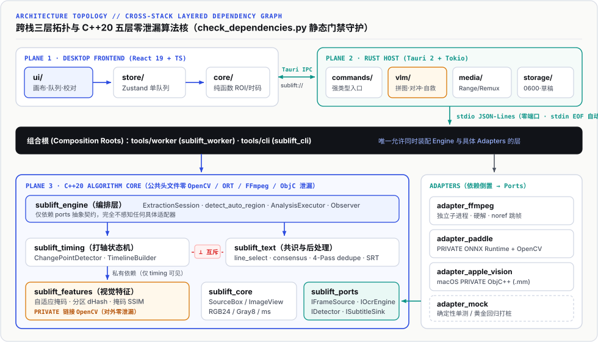

# 跨栈分层架构与工程治理

构建一个同时包含音视频解码、计算机视觉、神经网络推理、云端多模态调度与桌面富交互的系统，最大的风险不是单个模块写不出来，而是随着功能叠加，**第三方类型、业务状态和跨语言边界迅速腐化成一团难以测试的耦合代码**。

SubLift v1.0.0 在工程设计上贯彻一条主线：**把架构边界写成编译期类型约束和自动化静态门禁，而不是写在文档里的口头约定。**

---

## 1. 纯桌面单宿主与跨语言分工

SubLift 采用**纯桌面原生定位（Desktop-only）**，前端资源直接内嵌在 Tauri 2 窗口中，全链路通信走原生 IPC 与自定义协议，从根源上消除了本地 Web Server 常见的复杂性：

- **零本地监听端口**：无需占用 TCP 端口，不存在端口冲突、跨域（CORS）、CSRF 校验或 Cookie/Token 会话握手。
- **零 Python 运行时依赖**：产品级运行路径只包含原生二进制（C++20 算法核 / Worker + Rust 宿主），彻底摆脱虚拟环境、动态库路径漂移和冷启动包袱。

在此基础上，三种语言各司其职、绝不越界：

| 平面 | 技术栈 | 核心职责 | 严禁承担的职责 |
| --- | --- | --- | --- |
| **前端视图层** | React 19 + TypeScript + Zustand | 响应式交互、三栏工作台、画布 ROI 投影、`Undo/Redo` 校对状态 | 禁止执行解码、图像计算或接触明文 API Key |
| **桌面宿主与云端编排层** | Rust + Tokio（Tauri 2） | `sublift_worker` 进程守护、VLM 异步流式拼图与限流调度、`sublift://` 媒体流桥接、`AppData` 私有存储 | 禁止重写打轴、去重合并或 SRT 格式化算法 |
| **本地算力组合根与算法核** | C++20 + ObjC++ | 媒体探测与抽帧、自动选区、视觉特征与纯毫秒打轴、本地 Paddle/Vision 推理、4-Pass 合并与唯一权威 SRT 序列化 | 禁止引入网络服务、UI 状态或宿主持久化逻辑 |

---

## 2. C++20 算法核的五层拓扑与依赖倒置

`cpp/` 内部被严格拆分为 **5 层、7+ 个独立 CMake Target**，核心算法层与外部硬件/框架之间通过纯虚抽象接口（Ports & Adapters / 六边形架构）完全解耦：

### 模块职责与依赖矩阵

| Target | 所属层级 | 核心职责 | 允许依赖的内部 Target | 私有第三方依赖 |
| --- | --- | --- | --- | --- |
| `sublift_core` | 基础领域层 | 强类型坐标、`ImageView`/`ImageBuffer`、时间戳、错误模型 | 无 | 无（纯标准库） |
| `sublift_features` | 视觉特征层 | 双极性自适应掩码、分区 dHash、掩码局部 SSIM | `core` | `OpenCV`（`PRIVATE`） |
| `sublift_timing` | 时间轴领域层 | 纯毫秒变化点状态机、时间轴累积、代表帧保留 | `core`, `features` | 无 |
| `sublift_text` | 文本领域层 | 行评分、多帧共识、自动选区行聚类、4-Pass 去重、SRT 序列化 | `core` | 无 |
| `sublift_ports` | 抽象契约层 | `IFrameSource`、`IOcrEngine`、`IDetector`、`ISubtitleSink` | `core` | 无（纯接口头文件） |
| `sublift_engine` | 编排门面层 | `ExtractionSession`、`detect_auto_region`、并发分析执行器 | `core`, `ports`, `timing`, `text` | 无 |
| `adapter_*` | 适配器层 | `ffmpeg` / `paddle` / `apple_vision` / `mock` 具体实现 | `core`, `ports` | 各自私有隔离（ORT / ObjC++ / JSON） |
| `tools/{cli,worker}` | 组合根（Hosts） | 唯一允许同时装配 `engine` 与具体 `adapters` 的入口层 | `engine`, `adapters` | 仅限宿主协议层 |

### 五条架构硬约束不变式

1. **适配器隔离**：`core`、`features`、`timing`、`text`、`ports`、`engine` 绝不允许 `#include` 任何适配器头文件。
2. **领域正交互斥**：`timing` 与 `text` 彼此完全不可见（`timing ⊥ text`）——打轴只管像素与时间，不关心识别文本；文本后处理只管字符与时码区间，不关心帧签名。
3. **视觉特征私有化**：`features` 仅供 `timing` 消费；`engine`、`text`、`adapters` 均不可绕过边界直接引用 OpenCV 封装层。
4. **公共头文件零第三方类型泄漏**：`cpp/include/sublift/**` 与所有 `adapters/*/include/**` 严禁出现 `<opencv2/...>`、`onnxruntime_cxx_api.h`、`libav*`、`<nlohmann/...>` 或 Objective-C 语法（`#import`、`@interface` 等）。
5. **前端三层单向约束**：桌面端 `desktop/src/` 同样强制 `ui/ → store/ → core/` 单向引用，`core/` 保持 100% 纯函数可单测，不依赖 React 或 Tauri 运行时。

---

## 3. 零泄漏领域模型设计

### 3.1 强类型坐标体系：在编译期消灭坐标系混用

硬字幕处理涉及三个极易混淆的坐标空间：视频原始分辨率坐标、裁剪后帧内局部坐标、以及送入 OCR 模型的二次裁剪坐标。如果全部使用裸 `Rect` 或 `int[4]`，一旦传错空间，只会在运行时表现为“字幕偏移或截断”。

SubLift 在 `sublift_core` 中为三个空间定义了**编译期不可隐式互转**的强类型结构体：

- **`SourceBox`**：视频解码后真实分辨率下的绝对矩形（如 `1920×1080` 中的 `[0, 848, 1920, 87]`），也是前端画布框选与自动选区的唯一交换坐标。
- **`FrameLocalBox`**：相对于当前抽帧裁片左上角的局部坐标，供特征分析与检测器内部使用。
- **`OcrCropBox`**：OCR 检测器返回的文本框在识别输入图中的坐标，映射回源图必须经过显式转换函数。

### 3.2 `ImageView` / `ImageBuffer` 与规范色域契约

为了让算法核彻底摆脱 `cv::Mat` 侵入，同时保持高性能零拷贝传递：

- **`ImageView`** 是非拥有式只读视图（类似 `std::span` 的二维图像版本），仅持有 `const uint8_t* data`、`width`、`height`、`stride_bytes` 与 `PixelFormat`，支持 `O(1)` 零拷贝子区域切片（`view.roi(x, y, w, h)`）。
- **`ImageBuffer`** 是独占所有权的内存缓冲区，用于跨线程交接或状态机保存锚点帧/代表帧。
- **统一色域契约**：跨模块边界仅存在规范的 `RGB24` 与 `Gray8` 两种格式，在适配器入口完成转换，彻底根除 OpenCV 默认 `BGR` 通道对调带来的隐蔽 Bug。

### 3.3 纯毫秒时间基准与 `fail-closed` 错误语义

- 全系统彻底弃用“帧号（frame index）”作为状态机或时间轴基准，一律使用 `int64_t` **毫秒时间戳（`ms`）** 驱动，天然适配变帧率（VFR）视频、高帧率跳帧与起止区间截取；所有时码差值均采用溢出安全减法（`safe_sub`）。
- 遵循 **`fail-closed` 原则**：当用户请求的引擎（如非 macOS 请求 Apple Vision）、Paddle 模型文件或 `ffmpeg` 不可用时，系统明确返回结构化错误码，**严禁静默降级**到其他引擎或产出静默空文件。

---

## 4. 架构防腐蚀与四层测试治理

### 4.1 跨栈静态依赖检查（`scripts/check_dependencies.py`）

规则只有靠人审迟早会退化。SubLift 将所有分层与零泄漏规则固化进了 `scripts/check_dependencies.py`，并注册为 CTest 的 `unit` 必跑项（每次运行自动扫描全仓库 178 个跨栈源码与头文件、1000+ 条 `#include` / `import` 关系，并附带负向单测验证检查器自身不漏报）：

- 校验 C++ 五层与适配器之间的 `#include` 方向与互斥规则；
- 校验公共头文件零 OpenCV / ONNX Runtime / FFmpeg C 头文件 / nlohmann JSON / ObjC 语法泄漏；
- 校验 `tools/worker` 隔离边界以及 `desktop/src/{ui,store,core}` 单向导入边界。

### 4.2 四层测试门禁与卫生红线

为兼顾日常开发秒级反馈与发版前全链路可信度，SubLift 建立了严格分层的测试体系：

| 层级 | 触发时机 | 覆盖范围 | 外部依赖约束 |
| --- | --- | --- | --- |
| **`unit`**（CTest + Vitest + Cargo Test） | 每次修改代码必跑 | 纯内存算法单测、Mock 管道、协议编解码、依赖检查与测试卫生静态检查 | 零真实 `ffmpeg`、零真实模型、零长视频 |
| **`parity`**（8 组黄金回归） | 修改算法核或输出契约必跑 | `signature` / `changepoint` / `timeline` / `line_select` / `dedupe` / `pipeline` / `extractor` / `paddle` 对标冻结黄金基线 | 仅使用仓库内轻量化固定夹具 |
| **`adapter`** | 修改适配器或构建脚本必跑 | 真实 FFmpeg 短合成流、真实 ONNX Runtime Paddle 单帧夹具、Apple Vision 实机推理与 Worker 子进程通信 | 仅限短合成流或单张 fixture |
| **`e2e` 与整片基准层** | 合并主干与发版前必跑 | 30.5s 真实短片端到端冒烟（CTest）+ 254s 1080p 整片 3 路 F1/CER/耗时/RSS 门禁 + 并发确定性 & `SIGINT` 压测 | 唯一权威阈值源 `benchmark/gates.json` |

同时通过 `scripts/test_ctest_hygiene.py` 在测试期自动拦截两类常见反模式：严禁在功能单测中编写脆弱的墙钟耗时断言（如 `elapsed_ms < N`），并发取消与背压验证一律使用 `std::promise`、条件变量与确定性同步原语而非 `sleep_for` 猜时序。
