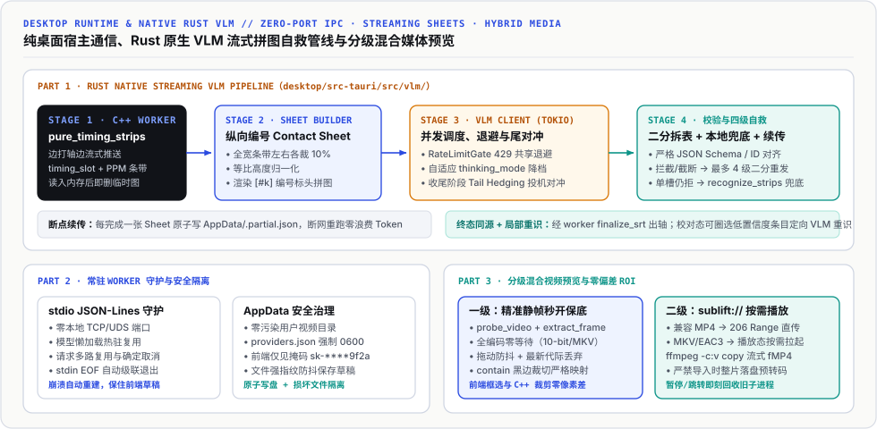

# 桌面宿主、三引擎协同与 VLM 流式管线

优秀的算法核只有配合顺手、稳健、低摩擦的宿主与交互工作台，才能真正成为高频使用的生产力工具。本篇聚焦 SubLift v1.0.0 在 **Rust/Tokio 桌面宿主**、**常驻 Worker 通信**、**三引擎首尾同源协同（尤其是 Rust 原生 VLM 流式管线）** 以及 **零预转码混合预览与校对工作台** 上的系统工程实践。

---

## 1. 常驻 `sublift_worker` 守护与 `stdio` JSON-Lines 协议

桌面宿主（Rust）与 C++20 本地算力核（`tools/worker`）之间没有使用本地 HTTP 端口或 Unix Domain Socket，而是直接采用**受控子进程 + `stdio` JSON-Lines 协议**（`stdin` 下发请求，`stdout` 严格专用于单行紧凑 UTF-8 JSON 事件/结果帧，`stderr` 隔离诊断日志）。

这套通信机制在桌面端具备四个天然优势：

1. **零端口与零鉴权开销**：不监听任何网络接口，免去端口抢占、防火墙弹窗与会话 Token 握手。
2. **模型按需懒加载与热驻复用**：`PaddleOcrEngine` 与 `AppleVisionOcrEngine` 在首次请求时加载并常驻内存，连续处理整季多集视频或在自动选区后紧接着开始提取时，彻底消除 ONNX Runtime 会话重复初始化的冷启动开销。
3. **父子生命周期硬绑定（绝不残留孤儿进程）**：Rust 宿主持有子进程 `stdin` 写端；一旦桌面窗口正常关闭或异常崩溃导致 `stdin` 到达 `EOF`，`sublift_worker` 立即触发协作式 `cancel()` 并安全退出，连带清理下属 `ffmpeg` 子进程。
4. **多路复用、确定性取消与崩溃隔离**：
   - Rust 侧 `worker::supervisor` 为每个请求分配唯一递增 `id`，支持慢速流式提取与快速元数据探测/单帧截取并存，且取消请求通过 `cancel_task(target_id)` 精准路由到目标会话（配合代际保护防止 ABA 延迟取消误杀复用任务）；
   - 即便极端损坏的视频文件触发底层解码库崩溃，Rust 宿主也能捕获退出码、将活动任务标记为可重试错误并自动拉起新 Worker，**前端界面与所有未导出的人工校对草稿毫发无损**。

### Worker 核心操作原语

| `op` 原语 | 职责 |
| --- | --- |
| `capabilities` | 探测编译期与运行期真实可用引擎（如 `paddle` / `apple_vision`）、`ffmpeg` 与硬解支持，驱动 UI 动态暴露 |
| `probe_video` / `extract_frame` | 探测真实解码旋转宽高与时长；按毫秒时刻原子抽取单帧原片用于静帧画布与局部重识 |
| `detect_auto_region` | 执行两阶段自动选区并返回推荐 `SourceBox` 与样本文本 |
| `run_extraction` | 双模式执行：`local_ocr`（流式吐出进度与字幕条目）或 `pure_timing_strips`（边打轴边原子写出中点条带并实时推送 `timing_slot`） |
| `recognize_strips` | 对指定单槽条带执行本地 OCR，作为 VLM 四级自救后的单槽本地兜底 |
| `finalize_srt` | 唯一权威 SRT 序列化出口，可选触发 C++ 4-Pass 合并 |
| `cancel_task` | 线程安全触发目标任务的协作式取消 |

---

## 2. 三引擎首尾同源与 Rust 原生 VLM 流式管线

### 2.1 三引擎协同：严守“首尾同源”与 `fail-closed`

SubLift v1.0.0 在同一套工作台内同时支持三类识别引擎：

- **PaddleOCR（Native ONNX Runtime）**：全平台默认离线引擎，内置自适应检测像素预算（`det_pixel_budget`，默认 `600000` 像素）平衡长字幕清晰度与推理耗时，模型与运行库均在 `resources/manifest.json` 中通过 SHA-256 锁定。
- **Apple Vision（macOS ObjC++）**：仅在 macOS 13.3+ 且启用 `SUBLIFT_ENABLE_VISION` 时编译注册，免外部模型文件即开即用；非 macOS 平台通过 `capabilities` 自动隐藏，不搞静默降级。
- **多模态大模型（VLM）**：兼容任意 OpenAI `/chat/completions` 视觉输入契约（预置 MiniMax、NVIDIA NIM 及自定义本地 vLLM / Ollama 端点）。

无论用户选择哪一个引擎，**前置的 `detect_auto_region` 与纯毫秒打轴、以及后置的 `sublift_text` 4-Pass 去重合并与 SRT 序列化全部复用同一套 C++ 实现**。不同引擎只替换“给图像条带出文本”这一中间环节，从而彻底消除了双轨时间轴漂移。

### 2.2 Rust 原生 VLM 流式管线（`desktop/src-tauri/src/vlm/`）

传统用大模型识别硬字幕的做法，要么把每条字幕单独发一次请求（延迟高、Token 贵、极易撞限流），要么等整部片子打轴结束再启动 Python 脚本批量发请求（等待久、依赖重）。SubLift 用纯异步 Rust（Tokio + Reqwest）原生构建了一套**边打轴、边拼图、边推理、可自救、可续传**的工业级 VLM 流式管线：

1. **流式消费与纵向编号 Contact Sheet 拼图（`sheet_builder.rs`）**：
   - 一边监听 `sublift_worker` 推送的 `timing_slot + PPM 条带`，一边在 Rust 内存中完成全宽条带左右各 10% 外缘裁切与等比高度归一化（读入内存后立刻删除临时 `.ppm`，零磁盘堆积）；
   - 攒满单张拼图容量或打轴结束时，自动将多条字幕纵向拼接为一张带高对比度 `[#k]` 编号标头的 **Contact Sheet** 发送给 VLM，把请求次数压缩一个数量级，同时大幅摊薄系统 Prompt 的 Token 开销。
2. **全局限流门控与尾延迟对冲（`rate_limit.rs` / `client.rs`）**：
   - 多个并发请求共享同一把 `RateLimitGate`：任一请求收到 HTTP `429` 或 `Retry-After` 时，全池统一退避并叠加随机抖动，避免并发雪崩；取消信号触发时门控立即唤醒退出；
   - 根据 Provider 档案自适应管理 `thinking_mode` 思考档位（遇到端点不兼容参数自动降档重试，避免死循环报错）；
   - **尾延迟投机对冲（Tail Hedging）**：当整片识别进入收尾阶段、仅剩个别在途请求显著慢于已完成分位耗时时，在限流门允许的前提下自动发起投机对冲请求，先返回合法结果者胜出并立即取消慢请求，显著压低长尾等待时间。
3. **严格 Schema 校验与四级二分降级自救（`schema.rs` / `client.rs`）**：
   - 返回结果自动剥离思考标签与 Markdown 围栏，严格校验 JSON 结构、条目数与局部 `[#k]` 编号重映射，拒绝重复 ID、非法类型或错位响应；
   - 当某张 Contact Sheet 遭遇远端内容审核拦截（`content_filter` / `refusal`）、`max_tokens` 截断或 Schema 校验失败时，系统**按二分法递归拆分子表重试（最多四级，直至单槽粒度）**，把单条敏感台词或异常帧的爆炸半径精准隔离在单槽之内，绝不拖垮整张拼图；
   - 若拆分到单槽仍被远端模型拒绝，自动委托 `sublift_worker::recognize_strips` 执行**本地 OCR 兜底**；若本地也无有效结果，则写入显式占位符并设置屏障阻断错误的跨槽相邻合并。
4. **Sheet 级断点续传与校对态局部 VLM 重识**：
   - 每完成一张 Contact Sheet 的校验，即按「视频强指纹 + ROI + 采样率 + 模型标识」在 `AppData` 原子落盘 `.partial.json` 断点；中途断网、取消或重启后再跑自动跳过已识别槽位，零重复 Token 消耗；
   - 主任务使用本地快速引擎提取完毕后，前端会高亮标出低置信度条目；用户可多选或一键勾选低置信度行触发**局部 VLM 重识**，宿主按区间中点截帧复用同一套 `vlm/` 管线回写，并生成一条支持一键 `Undo` 回退的修订记录。

---

## 3. 分级混合视频预览与零像素偏差 ROI

视频硬字幕工作台在预览上有一个经典两难：**WebView 原生 `<video>` 只认少数标准 MP4 编码，但影视素材大量是 MKV、10-bit HEVC 或 EAC3/DTS 音轨；如果导入时后台整片转码，既慢又疯狂吃硬盘。**

SubLift 在 `desktop/src-tauri/src/media/` 采用**两级零预转码混合预览契约**：

1. **第一级：FFmpeg 精准静帧秒开（全编码零等待保底）**
   - 无论什么容器或 10-bit 编码，拖入即通过 `probe_video + extract_frame` 秒开高清静帧用于框选字幕带与逐句核对；时间轴拖拽带防抖与最新代际丢弃，点击右侧任意字幕行瞬时定格到该句原片帧。
   - **零像素偏差 ROI**：画布依据 `probe_video` 返回的旋转后真实解码宽高计算等比 `contain` 显示矩形，禁止在黑边区域起框，越界拖拽自动钳位至有效画面边缘；归一化屏幕坐标与源像素 `SourceBox` 之间的双向取整规则由 `desktop/src/core/roi.ts` 唯一定义，确保“画布上框住哪一像素，C++ 裁剪的就是哪一像素”。
2. **第二级：`sublift://media` 按需动态音视频播放**
   - 原生兼容的标准 MP4：通过 Tauri 自定义协议 `sublift://media` 直接响应 RFC 9110 `206 Partial Content` 字节 `Range` 切片，零拷贝直传播放；
   - MKV 或非标音轨素材：**严禁导入时落盘预转码**；仅当用户显式点击播放时，Rust `media::remux` 从当前播放时刻按需拉起 `ffmpeg` 实时流式重封装为 fragmented MP4（视频流兼容时 `-c:v copy` 零重编码，仅轻量转码音频），暂停、大幅跳转或切换任务时立即杀死并回收旧进程，做到零磁盘缓存膨胀。

---

## 4. 单状态机统一队列、虚拟列表校对与安全治理

- **统一任务队列状态机**：放弃“单视频页面”与“批量任务中心”两套割裂视图，全应用只维护一个统一队列状态机（单视频即队列长度为 `1` 的特例，侧栏可折叠）：`idle → extracting → ready → exported`（外加显式 `cancelled` / `failed`）。整季多集场景下，第 1 集确认好字幕带 `SourceBox` 与参数后，可一键将选区与配置批量套用到队列其余待处理剧集，校对完成后一键批量导出至原片同目录同名 `.srt`。
- **高密度虚拟列表校对器**：基于 `@tanstack/react-virtual` 仅渲染视口可见行，保证数千条长片字幕 60fps 流畅滚动；支持行内文本编辑、起止毫秒微调、相邻合并、按光标位置与时间比例一键拆分、跨全片/跨队列批量查找替换以及完整 `Undo / Redo` 栈。最终写盘时前端仅提交结构化 `SubtitleEntry[]`，交由 `sublift_worker::finalize_srt` 生成唯一权威字节流并由 Rust 原子替换落盘。
- **隐私与本地安全红线**：
  - **零污染用户媒体目录**：运行期产生的队列草稿、预览临时帧与 VLM 断点文件严禁写入用户视频所在文件夹，用户目录只在显式导出时生成目标 `.srt`；
  - **最小权限凭据隔离**：多套 VLM 供应商配置保存在系统 `AppData` 私有目录的 `providers.json` 中，POSIX 权限强制 `0600`（且原子写盘拒绝符号链接攻击）；API Key 明文仅驻留 Rust 内存与 `0600` 文件，向前端与日志仅暴露掩码摘要（如 `sk-****9f2a`）；
  - **防抖草稿自动恢复**：按视频文件强指纹（规范化路径 + 文件字节数 + 修改时间哈希）500 ms 防抖保存校对草稿，损坏文件自动隔离恢复，重启工作台即可无感续接。
