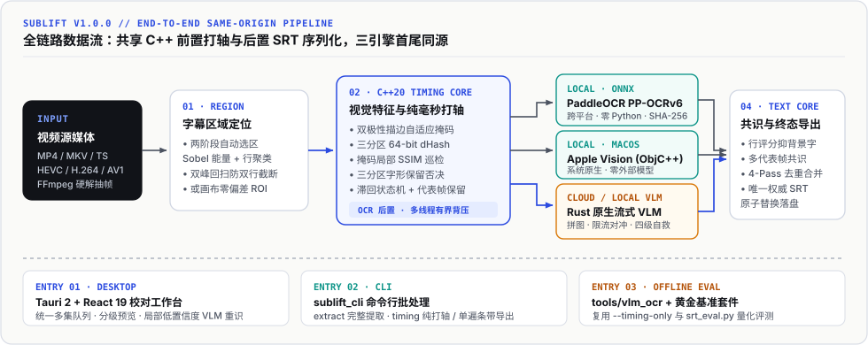

# SubLift

**SubLift** 是一款高性能、离线优先的视频硬字幕提取、时间轴精准对齐与桌面校对工作台。它从视频画面中自动定位并识别烧录在画面里的硬字幕，将其还原为可编辑、时间轴精准的 `.srt` 字幕文件。

整套系统围绕 **C++20 纯净算法核**、**Tauri 2（Rust / Tokio）原生桌面宿主** 与 **React 19 校对工作台** 构建，在本地离线场景下不依赖任何 Python 运行时，同时支持接入多模态大模型（VLM）获得复杂场景下的高精度转录与局部校对增强。

| 项目信息 | 说明 |
| --- | --- |
| **当前版本** | `v1.0.0`（[GitHub Releases](https://github.com/Hudea/SubLift/releases/tag/v1.0.0)） |
| **源码仓库** | [github.com/Hudea/SubLift](https://github.com/Hudea/SubLift) |
| **开源许可** | [Apache License 2.0](https://github.com/Hudea/SubLift/blob/main/LICENSE) |
| **核心技术栈** | C++20 / ObjC++ · Rust (Tokio / Tauri 2) · React 19 / TypeScript · ONNX Runtime · OpenCV · FFmpeg |

> **边界说明**：SubLift 专注于从视频像素中还原烧录硬字幕并生成规范化 SRT，不是封装层软字幕轨提取工具，也不内置机器翻译服务。

---

## 为什么做 SubLift

许多成片、影视压制源或教学录像只有烧进画面的硬字幕，没有独立字幕文件。传统方案通常面临四类工程痛点：

1. **逐帧 OCR 算力浪费且时间轴抖动**：对整片每秒跑数次 OCR 不仅极慢，还会因单帧遮挡、压缩伪影导致同一句字幕反复切碎或错字频出。
2. **背景干扰与宽字幕带漏切**：复杂动态画面下的传统灰度阈值掩码极易误触发，而整图 SSIM 在宽幅字幕条中又容易被大片背景稀释，导致相似长度的相邻字幕漏切。
3. **跨引擎语义分裂**：本地 OCR 与云端大模型若各自维护一套抽帧、切段与后处理逻辑，极易产生时间轴漂移与格式不一致。
4. **“提取完难校对”与运行时沉重**：命令行产出后仍需切换外部软件对轴校对；而传统基于 Python + 浏览器服务的方案往往带来沉重依赖、端口占用与媒体预转码磁盘膨胀。

SubLift v1.0.0 针对上述问题给出一套端到端系统解法：**OCR 后置的纯毫秒视觉打轴核 + 三引擎首尾同源 + 零端口原生桌面校对工作台**。

---

## 全链路架构与核心能力

### 双产品入口 × 三识别引擎

| 维度 | 组件 / 引擎 | 定位与特点 |
| --- | --- | --- |
| **产品入口** | **Tauri 2 桌面工作台** | 纯桌面单宿主（零本地端口），支持单集与整季多集统一队列、分级混合预览、ROI 精准框选、千条级虚拟列表校对与局部 VLM 重识 |
| **产品入口** | **`sublift_cli`** | 独立 Native 命令行工具，支持完整提取（`extract`）、纯打轴（`timing` / `--timing-only`）以及纯打轴单遍中点条带导出 |
| **本地引擎** | **PaddleOCR（ONNX Runtime）** | 全平台默认离线引擎，Native C++ 实现 Det/Cls/Rec 推理（零 Python），支持自适应检测像素预算与 SHA-256 模型清单校验 |
| **本地引擎** | **Apple Vision（macOS）** | 通过 ObjC++ 适配器私有封装系统 Vision 框架，零外部模型即开即用；非 macOS 平台经 `capabilities` 动态隐藏，绝不静默降级 |
| **大模型引擎** | **Rust 原生 VLM 流式管线** | 兼容任意 OpenAI `/chat/completions` 视觉端点（MiniMax / NVIDIA NIM / 自定义网关），支持纵向编号 Contact Sheet 拼图、429 共享退避、尾延迟对冲、四级二分降级自救与断点续传 |

---

## 核心工程亮点速览

- **OCR 后置与纯毫秒打轴引擎**：先通过**双极性描边自适应掩码**、**三分区 64-bit dHash** 与**掩码局部 SSIM** 完成视觉切段，并配合**三分区字形保留否决**与**周期 SSIM 巡检**压制误切和漏切，每段仅对少量代表帧执行 OCR 或抽取中点条带。
- **三引擎首尾同源**：无论选用 PaddleOCR、Apple Vision 还是 VLM，前置的自动选区、变化点打轴与后置的 4-Pass 去重合并及 SRT 序列化全部共用同一套 C++ 实现，保证时间轴与输出契约严格一致。
- **严格的五层零泄漏 C++20 算法核**：`core / features / timing / text / ports / engine / adapters` 单向分层与依赖倒置，公共头文件绝不泄漏 OpenCV、ONNX Runtime、FFmpeg 或 ObjC 类型，并由自动化静态检查脚本 `check_dependencies.py` 在每次测试中强制门禁。
- **纯桌面零防御税与零预转码预览**：Rust 宿主经 `stdio` JSON-Lines 看护常驻 `sublift_worker`（模型热驻、`stdin EOF` 级联回收防孤儿进程）；视频预览通过「FFmpeg 精准静帧秒开 + `sublift://` Range 直传 / MKV 按需 `-c:v copy` 流式 Remux」实现全格式秒开与零磁盘膨胀。
- **可量化、可复现的质量门禁**：全栈配备四层 CTest（`unit` / `parity` 黄金基线 / `adapter` / `e2e`）、前端 Vitest、Rust Cargo Test 及 254s 1080p 真片三路精度与资源门禁。

---

## 基准质量与性能门禁

SubLift 使用统一权威门禁配置（`benchmark/gates.json`）与唯一 SRT 评估器（`scripts/srt_eval.py`）对 254 秒 1080p 动画样片（5.0 fps 采样，本地 PaddleOCR 引擎）持续守护三条回归轨道：

| 评测轨道 | 选区模式 | F1 下限 | 匹配 CER 上限 | 端到端耗时上限 | 峰值 RSS 上限 |
| --- | --- | --- | --- | --- | --- |
| **`region`** | 显式精确 ROI | $\ge 0.990$ | $\le 0.040$ | $\le 20.0\text{ s}$ | $\le 450\text{ MB}$ |
| **`auto_region`** | 两阶段自动选区 | $\ge 0.980$ | $\le 0.040$ | $\le 22.0\text{ s}$ | $\le 550\text{ MB}$ |
| **`default`** | 底部 30% 宽带默认 | $\ge 0.895$ | $\le 0.090$ | $\le 45.0\text{ s}$ | $\le 650\text{ MB}$ |

> 在 `region` 与 `auto_region` 两条主力轨道上，254 秒 1080p 视频可在 20–22 秒内完成全链路解码、打轴、OCR 共识与 SRT 导出（超过 **11× 实时速度**），同时峰值物理内存稳定控制在 450–550 MB 以内。

---

## 本专题技术章节

本专题将 SubLift v1.0.0 按「架构骨架 → 打轴核心 → 首尾算法 → 桌面与多引擎工程」拆解为四篇深度技术文档，点击下方章节逐篇展开：

| 章节 | 主题 | 核心内容 |
| --- | --- | --- |
| **01** | [跨栈分层架构与工程治理](./architecture) | 跨语言分工边界、C++20 五层拓扑与依赖倒置、强类型零泄漏领域模型、跨栈静态依赖检查与四层测试门禁 |
| **02** | [视觉特征与纯毫秒打轴引擎](./timing-engine) | 双极性描边自适应掩码、三分区 64-bit dHash、零分配掩码 SSIM、三态滞回状态机、三分区字形保留否决与多线程背压收敛 |
| **03** | [自动选区、解码加速与文本共识后处理](./region-and-text) | 两阶段 Sobel 能量 + 双峰回扫自动选区、FFmpeg 硬解与 `noref` 跳帧、行评分与跨帧共识、4-Pass 去重合并与权威 SRT |
| **04** | [桌面宿主、三引擎协同与 VLM 流式管线](./desktop-and-vlm) | 常驻 `sublift_worker` (`stdio` JSON-Lines)、Rust 原生 VLM 拼图 / 限流对冲 / 四级二分自救、分级混合预览与安全治理 |
