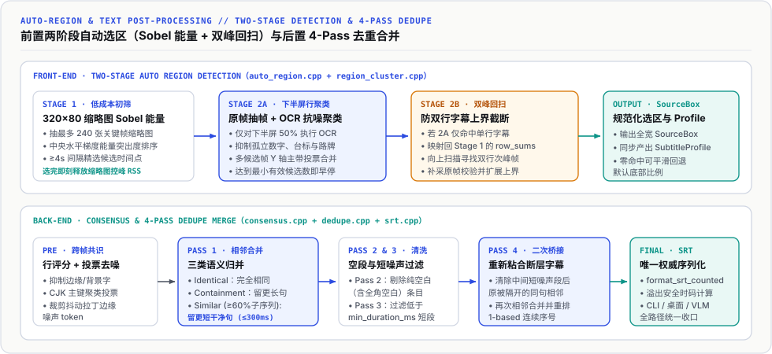

# 自动选区、解码加速与文本共识后处理

如果说视觉特征与纯毫秒状态机是 SubLift 算法核的“心脏”，那么本篇聚焦的是决定整条流水线**速度下限**与**成片干净度**的“前哨”与“收口”：

- **前哨**：怎样在用户不手动框选时，零全片扫描地精准找到字幕带（且不截断双行字幕、不拉爆峰值内存）？怎样让 FFmpeg 解码 1080p/4K 长视频跑出超过 11× 实时速度？
- **收口**：拿到每段字幕的多张代表帧 OCR 结果后，怎样滤除画面台标、广告牌与单帧错字，并把碎片化的识别条目规整成干净的权威 `.srt`？

---

## 1. 两阶段自动字幕区域探测（`detect_auto_region`）

手动框选字幕带虽然精确，但面对批量剧集或 CLI 无人值守场景，必须有高置信度的自动探测能力。如果直接对视频均匀抽几十张全分辨率原图做全屏 OCR，既慢又容易因为抽中大量空镜而白费算力。

SubLift 在 `cpp/src/engine/auto_region.cpp` 与 `cpp/src/text/region_cluster.cpp` 中设计了**「低成本缩略图初筛 → 下半屏 OCR 行聚类 → 双峰回扫验证」**两阶段探测管线：

### Stage 1：320×80 关键帧缩略图 Sobel 能量初筛

1. 通过 `FfmpegFrameSource::sample_keyframe_thumbnails` 仅解码关键帧底部区域（默认底部 45%），缩放到极轻量的 **`320 × 80` 灰度缩略图**（最多 240 张）。
2. 对每张缩略图中央水平区间 `x ∈ [81, 239)` 计算 Sobel 水平梯度边缘能量，统计每行高梯度像素计数 `row_sums[80]`，在 `y ∈ [24, 68]` 内寻找 12 行滑窗峰值能量 `energy` 与上方背景均值 `upper_mean`。
3. 以显著性条件（`energy >= 140` 且 `energy >= 1.5 × upper_mean`）降序排序，按至少 **4 秒间隔**精选少量高概率含字幕的候选时间戳。
4. **即时内存回收**：选出候选时间戳后立即 `thumbnails.clear(); thumbnails.shrink_to_fit()` 释放全部缩略图像素缓冲，防止前置阶段内存常驻叠加到后续提取阶段的峰值 RSS 中。

### Stage 2a：原帧下半屏 OCR 与抗噪聚类

1. 仅对精选的少量候选时间戳抽取全分辨率原帧，并只对**下半屏 50%** 区域执行 OCR，将文本框坐标还原回原始分辨率。
2. `cluster_frame_lines` 过滤孤立数字、边角水印与非目标文字体系的干扰行，对有效字幕行按纵向位置与字高聚类评分；收集到满足 `min_ocr_candidates` 的高质量候选帧即刻早停。
3. 通过 `merge_cluster_candidates` 融合多帧聚类结果，输出全宽 `SourceBox` 与配套 `SubtitleProfile`。

### Stage 2b：双峰回扫防双行字幕上界截断

实际影视剧中，大部分镜头是单行字幕，但偶尔会出现双行字幕。如果 Stage 2a 凑巧抽到的几帧全是单行，直接定死选区上界就会在后续正片中**把双行字幕的上面一行拦腰截断**。

为此，当 Stage 2a 尚未观测到双行聚类且尚有 OCR 预算时，系统触发 **Stage 2b 双峰回扫**：

- 将首轮检出的单行字幕带 Y 坐标映射回 Stage 1 保留的 80 行 `row_sums` 能量剖面；
- 在单行主峰上方搜索是否存在次级能量峰（双峰特征），定位高概率出现双行字幕的关键帧并补采原帧验证，从而在几乎不增加额外耗时的前提下把选区上界安全扩展到双行完整包络。

若极端素材（如无字幕空片）全程未检出有效字幕行，则根据配置平滑回退至默认底部裁剪比例，或显式返回 `detected = false`。

---

## 2. 解码与抽帧性能工程（`FfmpegFrameSource`）

在 1080p/4K 视频上，解码吞吐往往决定整条流水线的上限。SubLift 将 FFmpeg 严格封装在独立适配器 `cpp/adapters/ffmpeg/` 中，以**独立子进程（`posix_spawn` / 管道流）**运行，零库级 ABI 耦合，并在解码路径做了四项关键优化：

1. **自适应硬件加速与安全回退**：`--hwaccel auto` 基于编解码器、色深、分辨率与平台能力自动选择硬解（macOS 下启用 `videotoolbox`）；若特定损坏流或奇异编码导致硬解失败，自动按 `(hwaccel, skip_frame) → (软解, skip_frame) → (软解, 全帧)` 三级回退。
2. **高帧率智能 `noref` 跳帧**：当视频源帧率 $\ge 49.5\text{ fps}$ 且采样率满足 `source_fps >= sample_fps * 3.0`（例如 60 fps 视频按 5 fps 提取硬字幕）时，`resolve_effective_skip_frame` 自动开启 `-skip_frame noref`，直接跳过非参考 B 帧解码，大幅降低高帧率录屏与电影源的解码 CPU 占用。
3. **分析阶段缩放控制（`max_analysis_width`）**：支持在纯打轴路径默认将分析宽幅限制在 `1920 px` 以内，兼顾 4K 源的视觉打轴精度与内存带宽。
4. **单遍解码同步导出条带**：配合 `--timing-only --export-strips-dir`（及桌面 Worker 的 `pure_timing_strips`），打轴遍历视频的同时直接产出每段字幕中点条带，避免为 VLM 或二次校验重新寻帧解码整部影片。

---

## 3. 行评分、同段跨帧共识与背景字抑制

同一段字幕经由打轴切出后，通常会携带 2–4 张代表帧送入本地 OCR 引擎。哪怕已经裁在字幕带内，仍常出现两类污染：画面角落/路牌穿帮字，以及单帧动态模糊导致的错别字或首尾多出来的杂乱拉丁字母。

### 3.1 五维加权行评分与水平行桥接（`line_select.cpp`）

对每张代表帧返回的候选文本框 `OcrLine`，SubLift 先做同水平行碎片框桥接（`bridge_line_boxes`，避免一句带空格或标点的字幕被检测模型切成左右两截），再按五维加权模型综合打分：

$$
S_{\text{total}} = 0.40 \cdot S_{\text{script}} + 0.30 \cdot S_{y} + 0.15 \cdot S_{h} + 0.10 \cdot S_{c} + 0.05 \cdot \text{conf}
$$

- **$S_{\text{script}}$（40%）**：目标语言脚本匹配度（中文 / 拉丁 / 自动），强力压制中文字幕中混入的英文背景商标或乱码符号；
- **$S_{y}$（30%）**：行中心纵坐标相对 `SubtitleProfile` 主带中心的贴合度；
- **$S_{h}$（15%）**：字符高度与标准字幕字高的比例一致性，滤除超大场景招牌与极小角标；
- **$S_{c}$（10%）**：水平居中程度；
- **$\text{conf}$（5%）**：OCR 引擎自身置信度（刻意给低权重，防止背景里一个极清晰的广告字靠高置信度压过真正的字幕行）。

### 3.2 跨帧聚类投票与不稳定拉丁边缘裁剪（`consensus.cpp`）

拿齐同段多张代表帧的优选文本后，`consensus.cpp` 执行跨帧仲裁：

1. **CJK 主键聚类**：针对中文字幕，提取纯汉字序列作为 `consensus_key`，将同一句仅因标点或边缘噪点略有差异的候选帧归入同一簇，结合编辑距离（UTF-8 codepoint 粒度 `edit_distance`）与频次/置信度选出胜出簇。
2. **裁剪抖动拉丁边缘（`trim_unstable_latin_edges`）**：画面边缘滑过的背景物体常在某 1–2 帧被误识为句首/句尾几个随机英文字母（如 `I 你好啊`、`你好啊 r.`）。如果同一共识簇内不同代表帧的前导或尾随拉丁片段存在多个不一致变体（`variants.size() > 1`），系统自动将其判定为不稳定边缘噪声并干净剥离。

---

## 4. 4-Pass 去重合并与唯一权威 SRT 输出（`dedupe.cpp` & `srt.cpp`）

即使经过打轴防误切与同段共识，极复杂场景（如字幕被前景人物瞬间挡住超过滞回窗口、或 OCR 偶发插入单字噪点）仍可能产生少量相邻重复段或极短噪声段。`sublift::text::merge_entries` 采用确定性的 **4-Pass 流水线**完成最终清洗：

| 阶段 | 操作 | 核心设计细节 |
| --- | --- | --- |
| **Pass 1** | 首次相邻合并 | 去除全角/半角空白归一化后，将相邻条目分为三类归并： • `kIdentical`：完全相同，直接展宽时间区间； • `kContainment`：子串包含（如淡入残缺句被完整句包含），**保留更长句**； • `kSimilar`：较短句 $\ge 4$ 码点、占较长句 $\ge 60\%$ 且为其有序子序列，且间隔 $\le \min(\text{merge\_gap\_ms}, 300\text{ ms})$ —— 此类通常是较长句被 OCR 插入了背景噪点字，因此**反向保留更短的干净句**。 |
| **Pass 2** | 过滤空段 | 剔除纯空白（含全角空格等 Unicode 空白符）的无效条目。 |
| **Pass 3** | 过滤短噪声段 | 使用溢出安全减法过滤持续时长低于 `min_duration_ms` 的闪烁碎片。 |
| **Pass 4** | 二次相邻合并 | **关键一步**：Pass 2/3 清掉夹在中间的空白或短噪声段后，原本被隔开的两段相同字幕变成直接相邻，此时二次执行合并即可无缝重新粘合，并统一分配从 `1` 开始的连续序号。 |

最后，无论来自命令行 `sublift_cli`、桌面本地 OCR、还是 Rust VLM 管线与人工校对导出，所有 `.srt` 文本都**唯一收口**到 C++ `sublift::text::format_srt_counted` 序列化，确保全系统时码格式、换行与编号严格一致、零分叉。
