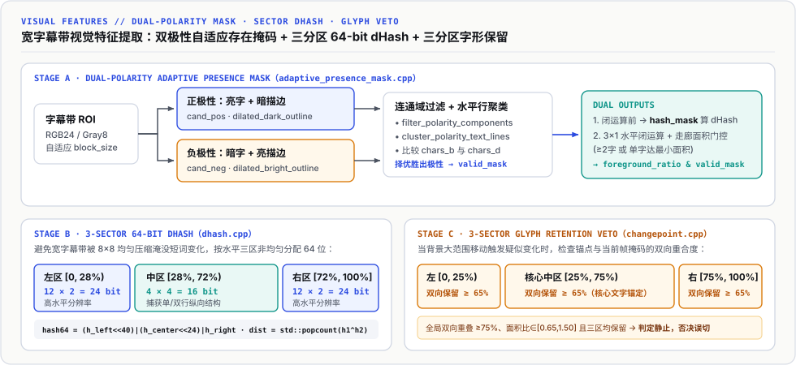
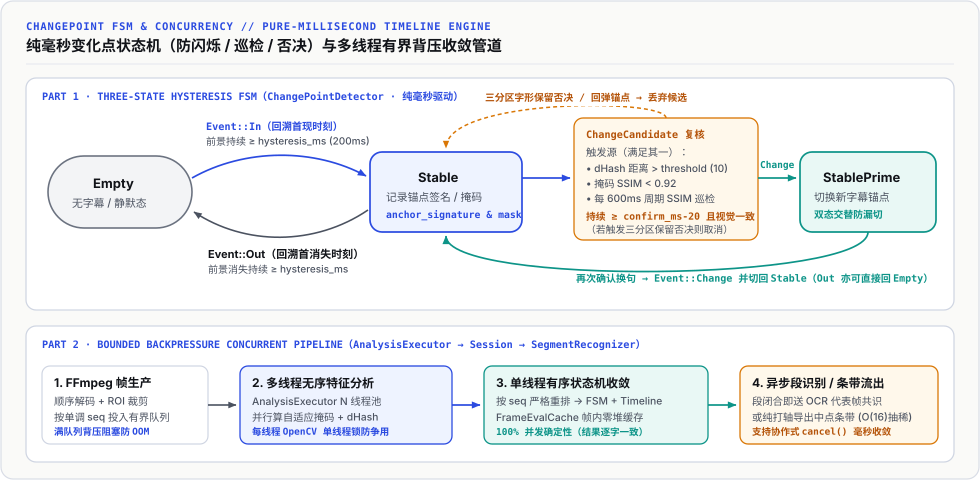

# 视觉特征与纯毫秒打轴引擎

硬字幕提取最容易陷入的误区，是把问题简单理解成“每 0.2 秒抽一帧跑一次 OCR，再去重合并”。在真实长视频中，这种做法会同时遇到两个死穴：

1. **算力浪费巨大**：一条 3 秒的对话在 5 fps 下有 15 帧，但文本内容完全一致，逐帧 OCR 意味着 90% 以上的神经网络推理都在做无用功；如果换成云端 VLM，延迟和 Token 成本更是不可接受。
2. **时间轴边界抖动**：画面背景变化、人物走过字幕区或压缩伪影都会让单帧 OCR 偶发多字/少字，直接基于 OCR 字符串切段极易把一句完整字幕打成碎片。

SubLift 的核心设计哲学是 **「OCR 后置」与「纯毫秒驱动」**：先用极轻量的视觉特征与滞回状态机精准切出每一段字幕的 `[start_ms, end_ms]` 区间，每段只收集少量代表帧交给本地 OCR 共识（或仅导出中点条带交给 VLM）。本章顺着 **「信号提取 → 状态机决策 → 并发有序收敛」** 的完整链路，拆解 SubLift 打轴引擎的关键实现。

---

## 1. 为什么彻底弃用帧号，全面转向纯毫秒语义

在早期视频处理工具中，常见用“连续 $K$ 帧”控制防闪烁、用“每 $N$ 帧巡检一次”控制周期检查。但帧数语义在真实视频里隐含了“固定帧率”假设——一旦遇到变帧率（VFR）视频、高帧率（60 fps）跳帧、或调整采样率（如从 5 fps 调到 2 fps），所有阈值都会随之失真。

SubLift 的 `TimingConfig` 全面以 **`int64_t` 毫秒（`ms`）** 作为唯一时间度量：

| 参数 | 默认值 | 语义 |
| --- | --- | --- |
| `hysteresis_ms` | `200 ms` | 字幕出现 / 消失滞回窗口，过滤瞬时闪现或单帧遮挡 |
| `confirm_ms` | `200 ms` | 相邻换句候选持续确认窗口，防背景突变引发误切 |
| `patrol_interval_ms` | `600 ms` | 稳定态周期性结构巡检间隔，兜底 dHash 漏检 |
| `ocr_anchor_delay_ms` | `400 ms` | 开段后延迟采集稳定锚点帧的时间偏移，避开淡入动画 |
| `aspect_ratio_threshold` | `6.0` | 判定宽字幕带（如 `1920×87`）的宽高比阈值 |

所有时间差计算统一经由溢出安全减法，无论上游采样帧率如何变化、是否跳过非参考帧，打轴状态机的时间行为都严格一致。

---

## 2. 视觉特征提取：在复杂动态背景下锁定字幕前景

打轴的第一步，是从字幕 ROI 中稳定分离“真正的文字笔画”与“晃动的背景纹理”。



### 2.1 双极性自适应存在掩码（`adaptive_presence_mask`）

普通的全局灰度阈值或单向 `adaptiveThreshold` 在复杂影视画面下非常脆弱：亮背景上的黑字、暗背景上的白字、彩色半透明物体边缘都会让二值掩码充满噪点。SubLift 采用了**双极性局部对比度 + 描边支持 + 双向外环校验 + 行聚类**的四步过滤：

1. **自适应高斯块与双极性对比度图**：根据字幕带有效高度计算奇数块尺寸 `block_size`，对原图做高斯模糊后分别计算**正极性**（`src - blur`，对应亮字+暗描边）与**负极性**（`blur - src`，对应暗字+亮描边）通道对比度，并提取反极性膨胀描边图（`dilated_dark_outline` / `dilated_bright_outline`）作为字形存在佐证。
2. **连通域外环背景校验（`has_two_sided_background_ring`）**：对每个候选连通域，先用 `floodFill` 填平封闭字形内部孔洞（如 `口`、`日`、`O`），再通过形态学膨胀差集 $\text{dilate}(7\times 7) \setminus \text{dilate}(3\times 3)$ 构造字形外围环形带，要求外环中至少 **65%** 的像素在 RGB 最大通道对比度上相对前景回落超过 $\max(20, 0.40 \cdot \text{peak\_c})$。这一步能干净滤掉窗户边框、衣领等单侧阶跃背景边，只保留四周被背景包裹的真实文字笔画。
3. **水平行聚类与极性择优（`cluster_polarity_text_lines`）**：分别对正/负极性通过过滤的连通域做水平文本行聚类，按有效字符数 `chars_b` vs `chars_d` 选出胜出极性，得到干净的 `valid_mask`。
4. **双轨输出与走廊面积门控**：
   - 在水平形态学闭运算**之前**，保留锐利的 `hash_mask` 用于计算 dHash，防止闭运算把字符间距糊平；
   - 随后对 `valid_mask` 执行 $3\times 1$ 水平闭运算，再按字符数与有效走廊面积（$\ge 2$ 字或单字达到最小面积阈值）做最终存在性门控，彻底压制偶发单点背景误判。

### 2.2 三分区 64-bit dHash（`compute_sector_dhash`）

常规的 `8×8` dHash 在处理宽幅字幕带（例如 `1920×87`，宽高比 $> 20$）时会产生严重畸变：水平 1920 像素被粗暴压缩到 9 列，短句切换或句尾改几个字几乎不改变哈希位。

为此，SubLift 对宽字幕带实现了**非均匀三分区 64 位 dHash**（`cpp/src/features/dhash.cpp`）：

- **左区 `[0, 28%)`**：采样为 `12 × 2` 网格 $\rightarrow$ **24 bit**（保留高水平分辨率，敏锐感知长句起止偏移）
- **中区 `[28%, 72%)`**：采样为 `4 × 4` 网格 $\rightarrow$ **16 bit**（字幕高频居中区，同时捕获单/双行纵向结构变化）
- **右区 `[72%, 100%]`**：采样为 `12 × 2` 网格 $\rightarrow$ **24 bit**

三段无缝拼装进单个 `uint64_t`：

```cpp
return ((h_left   & 0xFFFFFFULL) << 40) |
       ((h_center & 0xFFFFULL)   << 24) |
        (h_right  & 0xFFFFFFULL);
```

帧间汉明距离直接调用 C++20 硬件指令封装 `std::popcount(h1 ^ h2)`，单次比对仅需纳秒级开销。

### 2.3 掩码局部 SSIM 与宽条稀释归一化（`ssim.cpp`）

仅靠 dHash 仍存在盲区：两句长度相近、轮廓相似的字幕切换时，dHash 汉明距离可能刚好低于阈值 `change_threshold`（默认 `10`）。此时需要结构相似度（SSIM）做精细比对，但如果在 `1920×87` 的宽字幕带掩码上直接算全图 SSIM，会遇到**宽条稀释效应**：

> 真实文字笔画往往只占宽字幕带面积的 $3\% \sim 12\%$，其余 $90\%$ 都是全黑（`0`）背景。即使字幕彻底换了一句，全图原始 `raw_ssim` 依然可能高达 `0.95` 以上，轻松骗过 `0.92` 的阈值。

SubLift 在 `normalize_wide_mask_ssim` 中引入了两项关键补偿：

1. **膨胀并集占空比归一化**：先取两帧掩码的并集并做 $7\times 7$ 膨胀 $U = \text{dilate}(M_1 \lor M_2, K_{7\times 7})$，计算有效占空比 $f_{\text{active}} = |U| / (W \cdot H)$，截断至 $f_{\text{eff}} = \text{clamp}(f_{\text{active}}, 0.015, 0.13)$，并以参考占空比 $0.12$ 将不相似度放大归一化：
   $$
   \text{SSIM}_{\text{norm}} = \text{clamp}\!\left(1 - (1 - \text{SSIM}_{\text{raw}})\cdot\frac{0.12}{f_{\text{eff}}},\ 0,\ 1\right)
   $$
2. **双行半区独立比较**：当字幕带高度 $H \ge 60\text{ px}$ 且上下半区均有有效前景时，额外对上半区与下半区分别计算归一化 SSIM 取较小值，防止“双行字幕只换了一行”被另一行稀释掉变化信号。

同时在性能侧，为了消除 SSIM 计算中频繁创建/销毁 OpenCV 临时矩阵带来的堆分配抖动，SubLift 设计了 **`SsimWorkspace`**——将 23 个 `CV_64F` 中间矩阵打包映射到单块预分配连续 `std::vector<double>` 中跨帧复用，并前置**字节全等短路检测（`are_mats_byte_identical`）**，静止掩码直接 $O(N)$ `memcmp` 返回 `1.0`。

---

## 3. 纯毫秒变化点状态机：同时攻克“误切”与“漏切”

拿到前景占比、三分区 dHash 与掩码局部 SSIM 后，所有帧特征按严格时间序进入 `ChangePointDetector`（`cpp/src/timing/changepoint.cpp`）。



### 3.1 三态模型与滞回防闪烁

状态机仅维护三个简洁且完备的核心状态：`Empty`、`Stable`、`StablePrime`，输出三类离散事件：`Event::In`、`Event::Out`、`Event::Change`：

- **`Empty → Stable`（`In`）**：连续存在字幕前景的时间跨度达到 `hysteresis_ms`（200 ms）后确认字幕出现，但发出的 `In` 事件时间戳**回溯至首次观测到前景的时刻**，避免时间轴系统性晚偏 200 ms。
- **`Stable / StablePrime → Empty`（`Out`）**：前景持续消失达到 `hysteresis_ms` 后确认消失，同样回溯至首消失时刻。
- **`Stable ↔ StablePrime`（`Change`）**：两句字幕无缝衔接（中间没有空白间隔）时，经候选确认后直接发出 `Change` 事件并交替切换状态、刷新锚点签名与锚点掩码。

### 3.2 四道防线：精确平衡“防漏切”与“防误切”

真实视频里最棘手的矛盾在于：**放宽变化阈值容易因背景剧烈运动把一句静止字幕切成两段（误切）；收紧阈值又容易把无缝衔接的两句相似长度字幕混成一段（漏切）**。SubLift 通过四道正交机制协同求解：

1. **宽条主动补检 + 周期性 SSIM 巡检（防漏切）**：
   - 当 dHash 距离 $\le 10$ 未触发变化时，对宽字幕带进一步用掩码局部 SSIM 复核（`< 0.92` 即标记疑似变化）；
   - 即使始终停留在平静路径，每隔 `patrol_interval_ms`（600 ms）仍会执行一次 `maybe_patrol` 结构巡检，捕获渐进变化或低汉明距离换句。
2. **三分区字形保留否决（`check_sector_glyph_retention_veto`，防误切）**：
   - 当背景大范围移动或光影闪烁触发疑似变化时，将锚点掩码与当前帧掩码按水平 **[0, 25%) / [25%, 75%) / [75%, 100%]** 切分为左、中、右三个扇区，分别统计双向重叠保留率；
   - 若全局双向保留率均 $\ge 75\%$、面积比落在 $[0.65, 1.50]$ 之间，且所有活跃扇区的双向保留率均 $\ge 65\%$，说明**字形本身纹丝未动**，直接否决该次疑似变化并清空候选。
3. **候选持续确认窗口（`ChangeCandidate`）**：
   - 任何未被否决的疑似变化都不会立刻切段，而是先建档为 `ChangeCandidate`；
   - 后续帧必须与候选帧保持 dHash 接近、双向掩码重叠 $\ge 60\%$ 且掩码 SSIM 达标，持续达到 `confirm_ms - 20` ms 才正式发射 `Event::Change`（时间戳精准回溯至候选首帧）；若期间画面回弹至原锚点，则安全丢弃候选。
4. **帧内零堆求值缓存（`FrameEvalCache`）**：
   - 同一帧在主路径、候选复核与巡检路径中可能需要多次比较 `(cur_mask, anchor_mask)` 或 `(cur_mask, cand_mask)`。状态机内置 4 槽栈上 `FrameEvalCache`，以指针序对做键缓存当帧 SSIM 与双向重叠结果，做到零堆分配、零重复计算。

---

## 4. 代表帧保留与纯打轴单遍中点抽稀（`TimelineBuilder`）

当 `ChangePointDetector` 闭合一个时间段 `[start_ms, end_ms]` 时，`TimelineBuilder` 根据运行模式采取两种截然不同但同样省内存的帧保留策略：

- **本地 OCR 共识模式**：保留开段首帧、延迟 `ocr_anchor_delay_ms`（400 ms）后的稳定锚点帧、以及最多 `ocr_consensus_frames`（默认 4 帧）覆盖段首/段中/段尾的代表帧集合，供后续跨帧投票共识（避开淡入淡出和单帧遮挡）。
- **纯打轴流式条带模式（`pure_timing + retain_midpoint_in_pure_timing`）**：专为 VLM 流式管线设计——不需要保存多帧，只需要**单遍解码顺手导出每个字幕段正中点的高清条带**。由于段关闭前并不知道总时长，SubLift 设计了一个 $O(16)$ 有界抽稀缓冲：当长句超过 16 帧时，按**偶数索引 2× 等距抽稀**，在恒定极低内存下均匀覆盖整段起止跨度，段闭合瞬间直接选取最接近 `(start_ms + end_ms) / 2` 的帧原子写出条带，彻底避免二次 `ffmpeg` 寻帧开销。

---

## 5. 高并发、P-Core 感知与有界背压收敛（`AnalysisExecutor`）

视觉特征提取（高斯模糊、连通域分析、行聚类）是纯 CPU 密集型计算且帧间完全独立；而变化点状态机则严格依赖时间顺序。如果单线程串行跑，多核 CPU 利用率极低；如果直接多线程乱序推进状态机，结果又会因线程调度变成非确定性。

SubLift 在 `sublift_engine` 中构建了经典的 **「单生产 → 多线程无序并行分析 → 单线程有序重排收敛 → 异步段识别」** 四级流水线：

1. **有界滑动窗口背压**：`AnalysisExecutor::push` 通过条件变量强制约束 `next_push_index_ < next_consume_index_ + queue_capacity_`。当下游特征计算或状态机暂时变慢时，自动阻塞上游 FFmpeg 读帧线程，将内存峰值死死锁在常数级别，面对数小时 4K 视频也绝不 OOM。
2. **Apple Silicon P-Core 感知与防线程过度订阅**：
   - 在 macOS 上通过 `sysctlbyname("hw.perflevel0.physicalcpu")` 自动将分析线程池大小对齐到性能核（P-core）数量（钳位在 `[2, 8]`），避免慢速能效核（E-core）处理某一帧过慢而形成“队头阻塞”，卡住下游按 `seq` 顺序重排的窗口；
   - 每个工作线程入口调用 `ensure_opencv_single_thread()`，彻底消除外层线程池与 OpenCV 内部多线程嵌套引发的 $N \times M$ 上下文切换抖动。
3. **100% 并发确定性**：无论线程数设为 `1`、`4` 还是 `8`，按单调序号重排后进入 `ChangePointDetector` 的帧序列完全一致，因此多线程加速带来的输出与单线程**逐毫秒、逐字符完全一致**（并由端到端确定性回归脚本持续验证）。
4. **协作式快速取消**：调用 `session.cancel()` 会原子置位标志、同步向 `ffmpeg` 子进程发出终止信号并唤醒所有等待条件变量，确保用户在桌面端点击取消或按下 `SIGINT` 时毫秒级安全收敛且无死锁。
